# Guia Mestre de Latência Extrema: `moonlight-embedded-rpi3-v4l2` (Arch Linux RX 580 $\to$ Raspberry Pi 3B)

Este guia mestre consolida e verifica cruzadamente os quatro relatórios técnicos produzidos para streaming **720p60** (e avaliação **>60 fps**) entre um **Host Arch Linux x86_64** (**AMD Radeon RX 580 8GB Polaris 10 / VCE 3.4**, **Sunshine `v2026.1018.5342`**, Mesa `26.2.7`) e um **Cliente Raspberry Pi 3B** (**SoC BCM2837 / ARM Cortex-A53 / VideoCore IV / driver `bcm2835-codec` + `vc4-kms-v3d`**) executando `moonlight-embedded-rpi3-v4l2`.

> [!NOTE]
> **Critério Epistêmico e Rastreabilidade:**
> - **`[Fato Verificado]`**: comportamento diretamente auditado no código-fonte deste repositório (`src/video/v4l2*.c`, `libgamestream/sps.c`, `third_party/moonlight-common-c/`), no binário/sistema host (`/usr/bin/sunshine`, `vainfo`, `ffmpeg`, `libgallium`), nas fontes do kernel Linux (`bcm2835-codec`, `vc4`, `irq-bcm2836`, `usbnet`/`smsc95xx`) ou em documentação oficial Raspberry Pi.
> - **`[Estimativa / Experimento A/B]`**: projeções numéricas de latência *glass-to-glass* dependentes de medição em hardware real ou hipóteses comportamentais do firmware fechado VideoCore IV (`start.elf` / `vc.ril.video_decode`).

---

## 1. Resumo Executivo e Diagnóstico Ponta a Ponta

### 1.1 Mapa do Pipeline Atual vs Gargalos Reais

```mermaid
flowchart LR
    KMS["1. Host KMS (zero-copy DMA-BUF)"] --> VCE["2. RX 580 VCE 3.4 (h264_vaapi - GAP: strict VBV off)"]
    VCE --> NET["3. Sunshine TX + LAN (sendmmsg, FEC 20% / max 255 shards)"]
    NET --> USB["4. RPi 3B dwc_otg + smsc95xx (GAP: turbo_mode=Y batching)"]
    USB --> DEP["5. moonlight-common-c (GAP: LC_DEBUG, 4 slices, SCHED_OTHER)"]
    DEP --> V4L["6. V4L2 bcm2835-codec (GAP: 2x memcpy, poll mutex, SPS VUI, CMA)"]
    V4L --> DRM["7. VC4 DRM/HVS4 (zero-copy NV12 - GAP: eager commit +1 VBlank)"]
    DRM --> HDMI["8. HDMI 1.4 Scanout (max 162 MHz - sem modeset)"]
```



### 1.2 Diagnóstico Central e Correção de Mitos **[Fato Verificado]**

A auditoria cruzada entre o código-fonte, o binário do Sunshine e os drivers Linux da BCM2837 elimina diversos mitos comuns e expõe exatamente onde estão os atrasos evitáveis hoje:

1. **Armadilha de VBV no Host (`sunshine.conf` atual):** Embora `capture = kms`, `encoder = vaapi` e `vaapi_quality = speed` já estejam ótimos, usar `vaapi_rc = cbr` manual com `vaapi_strict_rc_buffer = disabled` (padrão) impede o modo **single-frame VBV** (`rc_buffer_size = bit_rate / frame_rate`). O VCE 3.4 gera rajadas enormes em transições de cena e telas estáticas, saturando o barramento USB 2.0 do RPi 3B e estourando o teto de **255 shards FEC** (`Skipping FEC for abnormally large encoded frame`). Já `min_threads = 1`, `sw_preset = ultrafast` e `VAAPI_DISABLE_INTERLACE` não têm efeito algum no caminho Mesa `26.2.7` VAAPI.
2. **Armadilha de Debug em `moonlight-common-c`:** Compilar com `CMAKE_BUILD_TYPE=Debug` define `-DLC_DEBUG`, ativando `#define FEC_VALIDATION_MODE` em [`RtpVideoQueue.c:4-10`](file:///home/gabriel/Projetos/CLI/moonlight-embedded-rpi3-v4l2/third_party/moonlight-common-c/src/RtpVideoQueue.c#L4-L10) e exigindo **+1 pacote de paridade FEC obrigatório em todo frame** mesmo com 0% de perda de pacotes. Builds de uso devem ser sempre `Release` ou `RelWithDebInfo`.
3. **Três falhas reais no `gs_sps_fix()` ([`libgamestream/sps.c:41-77`](file:///home/gabriel/Projetos/CLI/moonlight-embedded-rpi3-v4l2/libgamestream/sps.c#L41-L77)):**
   - Nunca força `vui_parameters_present_flag = 1` (se vier `0`, `write_seq_parameter_set_rbsp()` em `h264_stream.c` descarta todos os campos `vui.*`).
   - Só zera `num_reorder_frames = 0` dentro de `if (!vui.bitstream_restriction_flag)` (preserva reordenamento se o host enviar `bitstream_restriction_flag = 1`).
   - Nunca ativa `low_delay_hrd_flag = 1`. Sem DPB enxuto (`max_dec_frame_buffering = 1`, `num_reorder_frames = 0`), decodificadores rigorosos caem no DPB padrão do Level 3.2/4.1 (**4 a 5 frames = 66–83 ms a 60 fps**).
4. **Cópia dupla e contenção de mutex na entrada V4L2 ([`v4l2.c`](file:///home/gabriel/Projetos/CLI/moonlight-embedded-rpi3-v4l2/src/video/v4l2.c#L232-L259) + [`v4l2_codec.c`](file:///home/gabriel/Projetos/CLI/moonlight-embedded-rpi3-v4l2/src/video/v4l2_codec.c#L199-L275)):** Cada frame passa por `PLENTRY` $\to$ `bitstream_buf` $\to$ `output_bufs[free_idx].start` (duplo `memcpy` na RAM/L2 do ARM), e `v4l2_codec_feed_packet()` pode travar em `4 × poll(..., 3)` (**até 12 ms**) **segurando `state_mutex`**, bloqueando a `v4l2_event_thread` de drenar frames decodificados e flips DRM.
5. **Eager Commit no DRM (`v4l2_drm.c`) e por que `DRM_MODE_PAGE_FLIP_ASYNC` falha em `NV12`:**
   - O loop single-slot atual (`v4l2_drm_present` + `v4l2_drm_page_flip_handler`) comita um frame logo após o VBlank $V_k$; qualquer frame mais novo que chegue durante o intervalo até $V_{k+1}$ fica preso em `staged_frame_idx` até $V_{k+2}$ (**+16,67 ms** em streams >60 fps ou com jitter).
   - Embora o driver `vc4` anuncie `async_page_flip = true`, no código do kernel (`drivers/gpu/drm/vc4/vc4_plane.c`) `vc4_plane_async_set_fb()` e `vc4_plane_atomic_async_check()` hardcodam o plano `0` (`ptr0_offset[0]`) e **rejeitam `DRM_FORMAT_NV12` (2 planos) com `-EINVAL`** (além de kernels <6.8 rejeitarem a flag no ioctl atômico). A solução limpa e sem *tearing* nem patch de kernel é **VBlank Chasing (*Just-In-Time* Commit)** (~1,0–1,5 ms antes do próximo VBlank).
6. **Slicing (`CAPABILITY_SLICES_PER_FRAME(4)`):** Na RX 580 com Sunshine `v2026.1018.5342`, o servidor **não** falha (limita `slices` via `VAConfigAttribEncMaxSlices`), mas o cliente não ganha nenhum paralelismo sub-frame porque `RtpVideoQueue.c` / `VideoDepacketizer.c` aguardam o frame inteiro antes de chamar `submitDecodeUnit()` e `bcm2835-codec` decodifica por Access Unit inteira. Trocar para `CAPABILITY_SLICES_PER_FRAME(1)` elimina 4 resets de CABAC e cabeçalhos slice em 720p.
7. **Mitos de Kernel/Rede/Hardware na RPi 3B desfeitos:**
   - **`SO_BUSY_POLL`, `ethtool -C` e `--set-eee`:** todos inaplicáveis/no-op no `smsc95xx` (LAN9514) do RPi 3B (`usbnet_skb_return()` usa `netif_rx()` sem NAPI; EEE 802.3az só existe no RPi 3B+ `lan78xx`). O ajuste real é **`smsc95xx.turbo_mode=N`**.
   - **`PREEMPT_RT` vs `CONFIG_PREEMPT`:** Na BCM2837, o handler FIQ do `dwc_otg` conflita com locks RT e obriga `dwc_otg.fiq_enable=0`, degradando o USB/Ethernet sob carga contínua. **`CONFIG_PREEMPT` padrão com FIQ ativo** + **`isolcpus=2,3 nohz_full=2,3 rcu_nocbs=2,3 irqaffinity=0`** é superior para Moonlight.
   - **Armadilhas de `config.txt` / `vc4-kms-v3d`:** `hdmi_group`/`hdmi_mode`/`hdmi_cvt` são **ignorados** pelo Full KMS (`vc4-kms-v3d`); configure modo via `video=HDMI-A-1:...` no `cmdline.txt` (com `disable_fw_kms_setup=1`) ou atomic modeset no `v4l2_drm.c`. E nunca use `V4L2_DEC_CMD_STOP` / `OMX_BUFFERFLAG_EOS` por frame no `bcm2835-codec` (causa drain/trava conforme `raspberrypi/linux#5059` e `#7691`).
   - **CABAC vs CAVLC:** Não adiciona latência fixa de "1 frame inteiro (16,67 ms)" na VideoCore IV; impacta sim ciclos por macrobloco e jitter em quadros densos/alta taxa (>60 fps), onde `Constrained Baseline + CAVLC` exige patch local no Sunshine.

---

## 2. Orçamento Completo de Latência Ponta a Ponta (*Glass-to-Glass*)

> [!IMPORTANT]
> Os intervalos em **ms** abaixo combinam latências determinísticas medidas/calculadas (períodos de frame, VBlank, serialização 100BASE-TX) **`[Fato Verificado]`** com estimativas típicas por estágio de captura/encode/decode/scanout **`[Estimativa / Experimento A/B]`** aguardando instrumentação cronometrada no setup real.

### 2.1 Comparativo 720p60 vs >60 fps (Cada Estágio do Pipeline)

| Estágio do Pipeline | Baseline Atual (Com Gaps/Riscos Ativos) | Otimizado 720p60 (Sem Tearing, Zero Patch Kernel) | Extremo >60 fps: 720p120 em HDMI 120 Hz *(ou 720p120 $\to$ 60 Hz JIT)* | Evidência / Fator Dominante |
|---|---|---|---|---|
| **1. Captura Host (`capture = kms`)** | ~0,2 – 1,0 ms (já ótimo em KMS DMA-BUF) | ~0,2 – 1,0 ms | ~0,2 – 0,8 ms | [`docs/03 §3`](file:///home/gabriel/Projetos/CLI/moonlight-embedded-rpi3-v4l2/docs/03-sunshine-rx580-and-network-pipeline.md#L59-L74) |
| **2. Encode RX 580 VCE 3.4 (`h264_vaapi`)** | ~2,5 – 6+ ms *(picos se VBV padrão estourar)* | ~2,0 – 4,5 ms *(`strict_rc_buffer=enabled`, `slices=1`)* | ~1,8 – 3,5 ms *(ideal c/ patch `CAVLC`)* | [`docs/03 §4`](file:///home/gabriel/Projetos/CLI/moonlight-embedded-rpi3-v4l2/docs/03-sunshine-rx580-and-network-pipeline.md#L78-L152) |
| **3. Sunshine TX / FEC / Pacing + LAN 100Mbps** | ~2,0 – 10+ ms *(FEC 20%, microburst sem single-frame VBV, possível +1 shard `LC_DEBUG`)* | ~1,2 – 3,5 ms *(`fec_percentage=2..5`, Build Release, 10–15 Mbps)* | ~1,0 – 2,5 ms *(frame médio menor em ms, porém 2× frames/s no fio)* | [`docs/03 §5`](file:///home/gabriel/Projetos/CLI/moonlight-embedded-rpi3-v4l2/docs/03-sunshine-rx580-and-network-pipeline.md#L155-L211) |
| **4. RPi 3B `dwc_otg` + `smsc95xx` RX** | ~0,8 – 4,0 ms *(jitter `turbo_mode=Y`)* | ~0,3 – 1,2 ms *(`smsc95xx.turbo_mode=N`, FIQ ativo)* | ~0,3 – 1,2 ms *(2× IRQs USB na CPU 0)* | [`docs/03 §6`](file:///home/gabriel/Projetos/CLI/moonlight-embedded-rpi3-v4l2/docs/03-sunshine-rx580-and-network-pipeline.md#L214-L264) & [`docs/02 §6.2`](file:///home/gabriel/Projetos/CLI/moonlight-embedded-rpi3-v4l2/docs/02-vc4-drm-kms-hvs-display-latency.md#L301-L315) |
| **5. Depacketizer + `v4l2_submit` (`VideoRecv`)** | ~0,3 – 12+ ms *(2× `memcpy`, `SCHED_OTHER`, trava `state_mutex` até 12 ms em `poll`)* | **< 0,2 ms** *(zero-intermediate-copy, `SCHED_FIFO`, `mlockall`, `isolcpus`)* | **< 0,2 ms** | [`docs/01 §5.2`](file:///home/gabriel/Projetos/CLI/moonlight-embedded-rpi3-v4l2/docs/01-bcm2835-codec-v4l2-internals.md#L158-L168) & [`docs/04 §3.1`](file:///home/gabriel/Projetos/CLI/moonlight-embedded-rpi3-v4l2/docs/04-fpv-and-ingenious-low-latency-hacks.md#L177-L284) |
| **6. Decode VPU `bcm2835-codec` (720p)** | ~3 – 5 ms **+ risco de +16,7 a +83 ms** *(se DPB/VUI ou parser segurar 1–5 frames)* | ~2,5 – 4,5 ms *(SPS VUI rígido, fila curta; **0–16,7 ms** pendente teste A/B de AUD)* | ~2,0 – 3,5 ms *(OC `h264_freq=450..500`, `core_freq=450..500`, `force_turbo=1`)* | [`docs/01 §2, §4`](file:///home/gabriel/Projetos/CLI/moonlight-embedded-rpi3-v4l2/docs/01-bcm2835-codec-v4l2-internals.md#L36-L146) |
| **7. Espera DRM/VBlank (`v4l2_drm.c`)** | ~8,3 – 25,0 ms *(média 8,33 ms + até +16,67 ms por eager commit/jitter)* | ~1,5 – 9,5 ms *(VBlank Chasing JIT commit ~1,5 ms antes do VBlank + `clientRefreshRateX100` exato)* | **HDMI 120 Hz:** ~1,5 – 5,0 ms *(VBlank 8,33 ms)* / **60 Hz JIT 120fps:** ~5–6 ms *(idade $T_s/2 + \Delta$)* / **Async Kernel Patch:** ~0 ms *(c/ tearing)* | [`docs/02 §2.2, §3, §5.1`](file:///home/gabriel/Projetos/CLI/moonlight-embedded-rpi3-v4l2/docs/02-vc4-drm-kms-hvs-display-latency.md#L46-L145) |
| **8. Scanout HDMI + Scaler Display (Centro/Base)** | +8,0 ms (centro) / +16,0 ms (base) + **8–16+ ms** se TV lenta escalar 720p | +8,0 ms (centro) / +16,0 ms (base) + **< 1 ms** (monitor rápido ou HVS escalando p/ TV) | **HDMI 120 Hz:** +4,0 ms (centro) / +8,0 ms (base) *(ou 60 Hz QFT: +3,2 / +6,4 ms)* | [`docs/02 §4`](file:///home/gabriel/Projetos/CLI/moonlight-embedded-rpi3-v4l2/docs/02-vc4-drm-kms-hvs-display-latency.md#L151-L220) |
| **TOTAL Estimado (até Scanout Centro da Tela)** | **~25 – 60+ ms** *(podendo ultrapassar **100 ms** se DPB/VUI ou `LC_DEBUG` ativar retenção)* | **~16 – 28 ms** *(sujeito a validar se AUD remove +16,7 ms caso firmware retenha)* | **~11 – 18 ms em Monitor 120 Hz** *(~13 – 20 ms em 60 Hz c/ JIT 120fps)* | Estimativa composta de `docs/01..04` |

### 2.2 Viabilidade e Limites Físicos para >60 fps (`720p75`, `720p90`, `720p120`)

1. **Orçamento do Bloco H.264 na BCM2837 (`[Fato Verificado]` + `[Estimativa]`):**
   - `1280×720` possui $80 \times 45 = \mathbf{3.600\text{ macroblocks/frame}}$ (teto máximo por frame do hardware: `8.192` MBs e largura máx. `2.032` px; teto nominal Level 4.1: **`245.760` MB/s**).
   - `h264_freq` padrão de fábrica = `300 MHz` (`core_freq = 400 MHz`).
   - **720p60 (`216.000` MB/s = 87,9% Level 4.1):** confortável em clock stock.
   - **720p75 (`270.000` MB/s = 109,9%):** viável em stock/OC leve (~55% dos MB/s de 1080p60).
   - **720p90 (`324.000` MB/s = 131,8%):** requer OC (`h264_freq=400..500`, `core_freq=450..500`, refrigeração) e idealmente `CAVLC` no host.
   - **720p120 (`432.000` MB/s = 175,8%):** ~88% dos MB/s de 1080p60 (`489.600`), porém **dobra a taxa de ioctls V4L2/VCHIQ/IRQs para 120 Hz**, estando no limite do silício (exige OC agressivo + refrigeração ativa + `Constrained Baseline / CAVLC` se CABAC apresentar jitter p99).
2. **Orçamento HDMI 1.4 na BCM2837 ([`vc4_hdmi.c`](file:///home/gabriel/Projetos/CLI/moonlight-embedded-rpi3-v4l2/docs/02-vc4-drm-kms-hvs-display-latency.md#L259-L270)) `[Fato Verificado]`:**
   - `bcm2835_hdmi_variant` impõe **`max_pixel_clock = 162000000` (162 MHz)**.
   - **`1280x720@120Hz` padrão CTA-861 VIC 47 usa `148,50 MHz`** (ou ~115–125 MHz em CVT-RB) $\rightarrow$ **suportado nativamente sem patch no kernel**. (`1920x1080@120Hz` requer ~255–297 MHz e é fisicamente impossível na RPi 3B.)
3. **Efeito em Display de 60 Hz (`[Fato Verificado]` na matemática do código):**
   - **Sem VBlank Chasing nem Async Flip**, enviar >60 fps ao `v4l2_drm.c` atual **não melhora a latência**: o *eager commit* imediato em `v4l2_drm_page_flip_handler()` trava um frame no início da janela de 16,67 ms, fazendo o quadro exibido no VBlank seguinte ter **~20,8 ms** de idade média a 120 fps.
   - **Com VBlank Chasing (JIT commit)**, 120 fps em display 60 Hz reduz a idade média no VBlank de 8,33 ms para **$T_s/2 = \mathbf{4{,}17\text{ ms}}$** (~5–6 ms total na trava) com cadência uniforme 2:1 (sem *judder* irregular).

---

## 3. Plano de Ação Ranqueado (Master Action Plan)

Legenda de Categorias: **[A]** Código `moonlight-embedded-rpi3-v4l2` | **[B]** Bitstream / SPS / Codec | **[C]** RPi 3B OS / `config.txt` / `cmdline.txt` / Kernel / IRQ / Overclock | **[D]** Host Sunshine + Mesa VAAPI RX 580.

| Rank | Cat. | Ação Concreta | Ganho de Latência / Jitter | Impacto Visual | Risco / Trade-offs | Complexidade | Referência Cruzada |
|---:|:---:|---|---|---|---|---|---|
| **1** | **D** | Ativar **`vaapi_strict_rc_buffer = enabled`**, reduzir **`fec_percentage = 5`** (ou `1–5`), travar **`hevc_mode = 1`**, manter `lan_encryption_mode = 0`, `capture = kms`, `encoder = vaapi`, `vaapi_quality = speed`; testar A/B `cbr` vs `vbr` com strict VBV. | **Alto:** elimina picos VBV multi-frame na RX 580 e corta rajadas FEC de 20% $\to$ ~2–5% no USB 2.0 (**-2 a -15+ ms** em picos/drops). | Melhora estabilidade; `vbr + strict` evita degradação por padding em cenas paradas. | Nenhum relevante em LAN 100Mbps (`fec_percentage=0` só se 0% perda provada, pois `v4l2.c` não tem RFI). | **Trivial** *(configuração)* | [`docs/03 §2, §4.2, §5.2, §7.1`](file:///home/gabriel/Projetos/CLI/moonlight-embedded-rpi3-v4l2/docs/03-sunshine-rx580-and-network-pipeline.md#L43-L121) |
| **2** | **A** | Compilar sempre com **`-DCMAKE_BUILD_TYPE=Release`** (ou `RelWithDebInfo`), nunca `Debug`. | **-1 pacote/frame obrigatório** (~0,15–2 ms + elimina atraso esperando bloco extra de paridade em `RtpVideoQueue.c`). | Nenhum. | Menos logs/asserts de debug (`LC_DEBUG` / `FEC_VALIDATION_MODE` desligados). | **Trivial** *(build)* | [`docs/04 §0, §3.4`](file:///home/gabriel/Projetos/CLI/moonlight-embedded-rpi3-v4l2/docs/04-fpv-and-ingenious-low-latency-hacks.md#L325-L326), [`CMakeLists.txt`](file:///home/gabriel/Projetos/CLI/moonlight-embedded-rpi3-v4l2/third_party/moonlight-common-c/CMakeLists.txt#L65-L67) |
| **3** | **B** | Corrigir 3 bugs em **`gs_sps_fix()`** (`libgamestream/sps.c`): forçar `vui_parameters_present_flag = 1`, zerar `num_reorder_frames = 0` fora do `if`, `max_dec_frame_buffering = 1` (`>= num_ref_frames`), e `low_delay_hrd_flag = 1` quando HRD presente. | **Crítico (potencial -66 a -83 ms)** caso o host omita VUI ou envie `reorder > 0`, evitando DPB padrão de 4–5 frames no VideoCore IV. | Nenhum (stream Moonlight já não usa B-frames). | Baixíssimo, desde que `max_dec_frame_buffering >= 1` quando `num_ref_frames == 1` (conformidade H.264 Anexo E). | **Baixa** *(~15 linhas C)* | [`docs/01 §2.3`](file:///home/gabriel/Projetos/CLI/moonlight-embedded-rpi3-v4l2/docs/01-bcm2835-codec-v4l2-internals.md#L64-L71), [`docs/04 §1.3`](file:///home/gabriel/Projetos/CLI/moonlight-embedded-rpi3-v4l2/docs/04-fpv-and-ingenious-low-latency-hacks.md#L78-L120), [`sps.c`](file:///home/gabriel/Projetos/CLI/moonlight-embedded-rpi3-v4l2/libgamestream/sps.c#L56-L77) |
| **4** | **A** | **Zero-Intermediate-Copy** na entrada V4L2 + **desbloquear `state_mutex` no `poll()`**: adquirir `output_bufs[idx].start` fora do lock, escrever `PLENTRY`+`gs_sps_fix` direto no `mmap`, usar `_Atomic bool` (`running`/`streaming`) e normalizar retorno estritamente para `DR_OK`/`DR_NEED_IDR` (retornar `DR_OK` em backlog). | **-0,2 a -1,5 ms/frame** em CPU/cache L2 + **elimina stalls de até 12 ms** por retenção de `state_mutex` sobre `v4l2_event_thread`. | Nenhum. | Médio-baixo: exigir sincronização limpa com teardown/DRC (`STREAMOFF`) para não escrever em buffer não mapeado. | **Média** *(~80 linhas C)* | [`docs/04 §3.1`](file:///home/gabriel/Projetos/CLI/moonlight-embedded-rpi3-v4l2/docs/04-fpv-and-ingenious-low-latency-hacks.md#L177-L281), [`docs/01 §5.2`](file:///home/gabriel/Projetos/CLI/moonlight-embedded-rpi3-v4l2/docs/01-bcm2835-codec-v4l2-internals.md#L162-L168) |
| **5** | **A** | **VBlank Chasing (*Just-In-Time* Atomic Commit)** + **Atomic Modeset** (`720p@120Hz` se monitor suportar) + **`clientRefreshRateX100`** real (`5994`/`6000`/`12000`): segurar `drmModeAtomicCommit()` até ~1,0–1,5 ms antes do VBlank previsto em vez do *eager commit* pós-VBlank. | **-6 a -15 ms** (elimina 1 frame de fila DRM em >60 fps / jitter); em **HDMI 120 Hz** reduz VBlank para 8,33 ms (**-4,2 a -12 ms** adicionais). | **Zero tearing.** `clientRefreshRateX100` exato evita *beat drift* periódico entre 59,94 e 60,00 Hz. | Risco de perder VBlank (+16,67 ms) se o kernel sofrer spike; mitigar com margem adaptativa (+0,2 ms por miss) + `SCHED_FIFO` + `isolcpus`. | **Média-Alta** *(v4l2_drm.c)* | [`docs/02 §2.2, §3.2, §5`](file:///home/gabriel/Projetos/CLI/moonlight-embedded-rpi3-v4l2/docs/02-vc4-drm-kms-hvs-display-latency.md#L46-L140), [`docs/04 §2.2`](file:///home/gabriel/Projetos/CLI/moonlight-embedded-rpi3-v4l2/docs/04-fpv-and-ingenious-low-latency-hacks.md#L156-L165) |
| **6** | **A** | **Hardening `v4l2_drm.c`**: exigir `DRM_PLANE_TYPE_PRIMARY` na seleção do plano; pré-alocar `drmModeAtomicReqPtr` com `drmModeAtomicSetCursor(..., 0)` + `plane_needs_full_props` pós-DRC (`v4l2_drm_disable_plane_sync`); configurar `COLOR_ENCODING`/`COLOR_RANGE`. | **Sub-ms** de CPU por flip + evita consumo oculto de **~497,7 MB/s** na LPDDR2 caso `fbcon` `XRGB8888` ficasse ativo sob um overlay. | Corrige níveis de cor/luma BT.709 / faixa limitada vs completa. | Obrigatório resetar `plane_needs_full_props = true` em `v4l2_drm_disable_plane_sync()` para não falhar o 1º flip pós-DRC. | **Baixa** *(~40 linhas C)* | [`docs/02 §2.1, §4.1`](file:///home/gabriel/Projetos/CLI/moonlight-embedded-rpi3-v4l2/docs/02-vc4-drm-kms-hvs-display-latency.md#L25-L44), [`docs/04 §3.2`](file:///home/gabriel/Projetos/CLI/moonlight-embedded-rpi3-v4l2/docs/04-fpv-and-ingenious-low-latency-hacks.md#L288-L312) |
| **7** | **C** | **Kernel/Rede/IRQ no RPi 3B**: `smsc95xx.turbo_mode=N`; manter `CONFIG_PREEMPT` (não `PREEMPT_RT`) com `dwc_otg` FIQ ativo na CPU 0; `isolcpus=2,3 nohz_full=2,3 rcu_nocbs=2,3 irqaffinity=0`; `net.core.rmem_max=4194304` + `rmem_default=1048576`; opcional `ethtool -A eth0 rx off tx off`. | **-1 a -5 ms de jitter p99** (remove batching RX do LAN9514, previne drops silenciosos de `SO_RCVBUF` 2,88 MB e evita ticks/daemons nas CPUs do player). | Nenhum. | Aumenta IRQs USB na CPU 0 (compensado por deixar CPUs 0–1 para o SO e FIQ ligado); em Wi-Fi usar `iw dev wlan0 set power_save off`. | **Baixa** *(cmdline/sysctl via `pkexec`)* | [`docs/02 §6.2–6.3`](file:///home/gabriel/Projetos/CLI/moonlight-embedded-rpi3-v4l2/docs/02-vc4-drm-kms-hvs-display-latency.md#L301-L341), [`docs/03 §6.2, §6.4`](file:///home/gabriel/Projetos/CLI/moonlight-embedded-rpi3-v4l2/docs/03-sunshine-rx580-and-network-pipeline.md#L223-L264) |
| **8** | **A/C** | **Scheduling Real-Time Completo + `mlockall()`**: `SCHED_FIFO` em `InputSend`(48), `VideoRecv`(46, CPU 2), `v4l2_event_thread`(45, CPU 3), `Audio/Control`(40–42) + `mlockall(MCL_CURRENT \| MCL_FUTURE)` + `limits.d` ou `pkexec setcap cap_sys_nice,cap_ipc_lock+ep`. | Evita preempção silenciosa (`EPERM` atual no `v4l2.c` sem `CAP_SYS_NICE`) e elimina *page faults* (**-1 a -8 ms p99** sob carga do SO). | Nenhum. | Manter prioridades `< 50` para não bloquear eventuais threads IRQ/sistema; `mlockall` fixa RAM do processo. | **Baixa-Média** *(C + `setcap`)* | [`docs/04 §3.4`](file:///home/gabriel/Projetos/CLI/moonlight-embedded-rpi3-v4l2/docs/04-fpv-and-ingenious-low-latency-hacks.md#L331-L338), [`docs/02 §6.3`](file:///home/gabriel/Projetos/CLI/moonlight-embedded-rpi3-v4l2/docs/02-vc4-drm-kms-hvs-display-latency.md#L330-L341) |
| **9** | **B** | Mudar `CAPABILITY_SLICES_PER_FRAME(4)` $\to$ **`CAPABILITY_SLICES_PER_FRAME(1)`** em [`v4l2.c:277`](file:///home/gabriel/Projetos/CLI/moonlight-embedded-rpi3-v4l2/src/video/v4l2.c#L277). | **Sub-ms** (menos trabalho no front-end de entropia CABAC do VideoCore IV e menos cabeçalhos NAL por frame). | Leve **melhora** visual em mesmo bitrate (sem resets CABAC e sem quebra de predição intra a cada 11 linhas de MB). | Nenhum em `bcm2835-codec` stateful nem no Sunshine RX 580. | **Trivial** *(1 token em C)* | [`docs/01 §4.2`](file:///home/gabriel/Projetos/CLI/moonlight-embedded-rpi3-v4l2/docs/01-bcm2835-codec-v4l2-internals.md#L132-L145), [`docs/03 §4.4`](file:///home/gabriel/Projetos/CLI/moonlight-embedded-rpi3-v4l2/docs/03-sunshine-rx580-and-network-pipeline.md#L148-L150), [`docs/04 §2.2.3`](file:///home/gabriel/Projetos/CLI/moonlight-embedded-rpi3-v4l2/docs/04-fpv-and-ingenious-low-latency-hacks.md#L167-L171) |
| **10** | **A/B** | **Reduzir filas CMA em `v4l2_codec.c`**: `OUTPUT` `req.count` **`12 -> 4`** (linha 97) e `CAPTURE` **`clamp(min_bufs + 8, 12, 20)` $\to$ `max(min_bufs + 3, 5)`** (linhas 373–377). | Economiza **~20–25 MiB de CMA**; impede *bufferbloat* multi-frame no firmware MMAL sob backpressure e reduz risco de leaks/timeouts em DRC (`#3325`, `#7163`). | Nenhum. | Abaixo de `min_bufs + 2` pode causar starvation no `device_run()` (+16,67 ms); `min_bufs + 3` cobre DPB + scanout + staged + próximo frame. | **Trivial** *(~5 linhas C)* | [`docs/01 §5.2`](file:///home/gabriel/Projetos/CLI/moonlight-embedded-rpi3-v4l2/docs/01-bcm2835-codec-v4l2-internals.md#L158-L182), [`docs/04 §3.3`](file:///home/gabriel/Projetos/CLI/moonlight-embedded-rpi3-v4l2/docs/04-fpv-and-ingenious-low-latency-hacks.md#L316-L319) |
| **11** | **C** | **Tuning de Clocks e Memória (`/boot/firmware/config.txt`)**: `force_turbo=1`, `gpu_mem=64`, `dtoverlay=vc4-kms-v3d,cma-192` (ou `256`), `disable_fw_kms_setup=1`; overclock seletivo (`arm_freq=1300..1350`, `core_freq=450..500`, `h264_freq=400..500`, `sdram_freq=500..550`, `over_voltage=2..4`); **não usar `gpu_freq=`**. | **-0,5 a -2 ms** no decode + elimina DVFS entre P-frames/I-frames (**jitter**) + habilita **720p90/120**. | Nenhum. | Exige **dissipador + ventoinha** e fonte 5V $\ge$ 2,5A (evitar throttle a 85 °C); `force_turbo=1` + `over_voltage>0` grava bit permanente de OC no SoC. | **Baixa** *(config boot via `pkexec`)* | [`docs/02 §6.1`](file:///home/gabriel/Projetos/CLI/moonlight-embedded-rpi3-v4l2/docs/02-vc4-drm-kms-hvs-display-latency.md#L276-L299), [`docs/01 §4.1`](file:///home/gabriel/Projetos/CLI/moonlight-embedded-rpi3-v4l2/docs/01-bcm2835-codec-v4l2-internals.md#L112-L120) |
| **12** | **D** | **Tuning Rede Host Arch Linux + Parâmetros Moonlight**: `net.core.default_qdisc = fq` (ou `fq_codel`), `ethtool --set-eee <iface> eee off`, testar `rx-usecs 0` / `tx-usecs 0` na NIC PCIe; cliente em `-bitrate 10000..15000 -packetsize 1392`. | **-0,2 a -1,5 ms** (evita despertar LPI do Gigabit Ethernet e reduz pacotes/frame vs 1024 B em ~26%). | Equilíbrio ótimo de qualidade 720p vs contenção USB `smsc95xx` (acima de 20–25 Mbps eleva jitter em controles USB). | Alguns drivers NIC PCIe não suportam `tx-usecs 0`; testar antes de persistir via udev/systemd. | **Baixa** *(sysctl/ethtool via `pkexec`)* | [`docs/03 §6.3–6.4, §7.2`](file:///home/gabriel/Projetos/CLI/moonlight-embedded-rpi3-v4l2/docs/03-sunshine-rx580-and-network-pipeline.md#L236-L301) |
| **13** | **B** | *(Experimento A/B)* **Trailing AUD (`00 00 00 01 09 F0`)** ao fim de cada frame em `v4l2_submit_decode_unit()` + **HRD sintético** (`vcl_hrd_parameters_present_flag=1` + `low_delay_hrd_flag=1`). | **Potencial de -16,67 ms (1 frame a 60 Hz)** se a revisão de firmware `start.elf` retiver o AU atual esperando o próximo start code. | Nenhum se o parser aceitar; **risco de regressão** se o firmware abrir AU espúrio ou gerar erro de drain. | **Só adotar se benchmark `QBUF->DQBUF` em 1 frame isolado provar ganho real no Pi 3B.** | **Baixa** *(experimento C)* | [`docs/01 §2.3`](file:///home/gabriel/Projetos/CLI/moonlight-embedded-rpi3-v4l2/docs/01-bcm2835-codec-v4l2-internals.md#L74-L77), [`docs/04 §1.2–1.3`](file:///home/gabriel/Projetos/CLI/moonlight-embedded-rpi3-v4l2/docs/04-fpv-and-ingenious-low-latency-hacks.md#L52-L89) |
| **14** | **A** | *(Experimento A/B)* **`recvmmsg()`** em `PlatformSockets.c` + comparar **`V4L2_PIX_FMT_NV12` vs `V4L2_PIX_FMT_YUV420` (`YU12`, 1 plano)** na VPU + decidir **720p nativo vs 1080p HVS** por display. | `recvmmsg`: menos syscalls em bursts. `YU12`: possível **-0,3 a -1 ms** na VPU se evitar empacotamento UV (vs 3º stream DMA no HVS4). | TVs antigas: HVS escalando `720p->1080p` evita **+8–16 ms** do scaler da TV. Monitores rápidos: `720p` nativo poupa HVS e libera **>60 Hz**. | Trocar para `YU12` usa 3 canais DMA no HVS4; só manter se `QBUF->DQBUF` + `page_flip` medido melhorar no conjunto. | **Média** *(experimento A/B)* | [`docs/01 §3.1`](file:///home/gabriel/Projetos/CLI/moonlight-embedded-rpi3-v4l2/docs/01-bcm2835-codec-v4l2-internals.md#L81-L105), [`docs/02 §4.3`](file:///home/gabriel/Projetos/CLI/moonlight-embedded-rpi3-v4l2/docs/02-vc4-drm-kms-hvs-display-latency.md#L198-L209), [`docs/04 §3.4`](file:///home/gabriel/Projetos/CLI/moonlight-embedded-rpi3-v4l2/docs/04-fpv-and-ingenious-low-latency-hacks.md#L340-L341) |
| **15** | **B/D** | *(Avançado >60 fps)* Patch local no **Sunshine (host)**: forçar **`VAProfileH264ConstrainedBaseline`** + **`coder = cavlc`** no `h264_vaapi`. | Reduz carga e jitter **p99** de entropia no VideoCore IV em **720p90 / 720p120** e proíbe ferramentas High no PPS. | Requer **+10–15% de bitrate** para igual qualidade vs CABAC (aceitável a 12–15 Mbps em 720p). | Exige manter build/PKGBUILD customizado do Sunshine no Arch Linux. | **Alta** *(fork C++ host)* | [`docs/03 §4.3`](file:///home/gabriel/Projetos/CLI/moonlight-embedded-rpi3-v4l2/docs/03-sunshine-rx580-and-network-pipeline.md#L122-L140), [`docs/01 §4.1`](file:///home/gabriel/Projetos/CLI/moonlight-embedded-rpi3-v4l2/docs/01-bcm2835-codec-v4l2-internals.md#L125-L130) |
| **16** | **C** | *(Último recurso / Tearing ON)* Patch kernel **`vc4_plane.c`** para `async_page_flip` multi-planar `NV12` (`ptr0_offset[0]` e `[1]`) + `DRM_MODE_PAGE_FLIP_ASYNC` (ou *DIY QFT Large VTotal* em 60 Hz). | **-4 a -8,33 ms** médios adicionais em 60 Hz eliminando espera de VBlank. | **Introduz *screen tearing*** visível (além de 1 scanline potencialmente com croma dessincronizado na troca Y/UV). | Exige compilar/manter kernel Linux customizado na RPi 3B; em `720p120` nativo ou VBlank Chasing não costuma valer o custo. | **Muito Alta** *(kernel C)* | [`docs/02 §3.1, §4.4`](file:///home/gabriel/Projetos/CLI/moonlight-embedded-rpi3-v4l2/docs/02-vc4-drm-kms-hvs-display-latency.md#L81-L148) |

### Anti-Padrões Verificados (O Que **NÃO** Fazer)
- **NÃO enviar `V4L2_DEC_CMD_STOP` / `V4L2_BUF_FLAG_LAST` / `OMX_BUFFERFLAG_EOS` por frame no `bcm2835-codec`:** aciona drain formal V4L2 M2M e expõe travamentos/perda de frames documentados em `raspberrypi/linux#5059` e `#7691`.
- **NÃO ativar `SO_BUSY_POLL`, `ethtool -C` ou `--set-eee` na `eth0` da RPi 3B:** são inúteis ou não suportados no `smsc95xx` + `usbnet`.
- **NÃO usar `PREEMPT_RT` com `dwc_otg.fiq_enable=0` na RPi 3B:** piora a carga de CPU das interrupções USB/Ethernet do streaming contínuo.
- **NÃO usar `lan_encryption_mode = 2` no Sunshine para a RPi 3B:** o BCM2837 não tem extensão ARMv8 AES (`has_fast_aes() == false`), forçando AES-GCM em software e roubando 32 bytes/pacote.
- **NÃO usar `gpu_mem=16` (desliga o decoder HW), `gpu_mem=256+` (estrangula Linux + CMA), nem `hdmi_cvt` no `config.txt` sob `vc4-kms-v3d` (ignorado).**

---

## 4. Roteiro Concreto de Próximos Passos (Implementação e Validação)

> [!CAUTION]
> Comandos administrativos marcados com `pkexec` ou edições em `/boot/firmware/` e `/etc/` alteram o sistema operacional e exigem confirmação explícita antes de aplicar no host ou na Raspberry Pi 3B.

### Fase 0 — Diagnóstico Baseline (Sem Alterar Código)
1. **No Host Arch Linux:** validar VCE 3.4 e logs atuais do Sunshine:
   ```bash
   vainfo --display drm --device /dev/dri/renderD128 | grep -E "H264|HEVC|EncSlice"
   journalctl --user -u sunshine -n 120 | grep -E "VAAPI|VBV|FEC|Increasing FEC|Skipping FEC"
   ```
2. **Na Raspberry Pi 3B:** coletar estado real de codec, clocks, temperatura, throttling, CMA e rede antes de qualquer modificação:
   ```bash
   v4l2-ctl -d /dev/video10 --all --list-ctrls --list-formats-out-ext --list-formats-ext
   vcgencmd measure_clock arm core h264 && vcgencmd measure_temp && vcgencmd get_throttled
   grep -i cma /proc/meminfo
   cat /sys/module/smsc95xx/parameters/turbo_mode
   sysctl net.core.rmem_max net.core.rmem_default
   ```
3. **Medir latência de base:** fotografar cronômetro / câmera 120–240 fps (ou *latency overlay* + LED no botão do gamepad) e, em streaming ativo, checar `v4l2-ctl -d /dev/video10 --get-ctrl=min_buffers_for_capture` (para saber se o DPB hoje está inflado >2–3) e `grep -A1 '^Udp:' /proc/net/snmp` (checar `RcvbufErrors`).

### Fase 1 — Ganhos Imediatos de Configuração (Zero Patch de C)
1. **Host (`sunshine.conf`):** aplicar `vaapi_strict_rc_buffer = enabled`, `fec_percentage = 5`, `hevc_mode = 1`, `lan_encryption_mode = 0`, `vaapi_blbrc = disabled`. Reiniciar Sunshine e confirmar nos logs: `[VAAPI] Using ... rate control with single frame VBV size`. Testar A/B `vaapi_rc = cbr` vs `vbr`.
2. **Host (`/etc/sysctl.d/99-sunshine-latency.conf` + NIC):** testar `net.core.default_qdisc = fq` e `ethtool --set-eee <iface> eee off` (via `pkexec` se aplicável).
3. **Cliente RPi 3B:**
   - `/boot/firmware/config.txt`: `force_turbo=1` (somente com dissipador + fan!), `gpu_mem=64`, `dtoverlay=vc4-kms-v3d,cma-192` (ou padrão `256`), `disable_fw_kms_setup=1`.
   - `/boot/firmware/cmdline.txt` (linha única): `smsc95xx.turbo_mode=N isolcpus=2,3 nohz_full=2,3 rcu_nocbs=2,3 irqaffinity=0` (e `video=HDMI-A-1:1280x720@60D` ou `@120D` se monitor rápido).
   - `/etc/sysctl.d/99-moonlight-rpi3.conf`: `net.core.rmem_max = 4194304` e `net.core.rmem_default = 1048576`.
   - Build do cliente sempre com `-DCMAKE_BUILD_TYPE=Release` (verificar `LC_DEBUG` ausente).

### Fase 2 — Implementação em Código no `moonlight-embedded-rpi3-v4l2` (Em Etapas Testáveis)
1. **Etapa 2A (Bitstream & SDP):**
   - Corrigir [`gs_sps_fix()`](file:///home/gabriel/Projetos/CLI/moonlight-embedded-rpi3-v4l2/libgamestream/sps.c#L56-L77) (`vui_parameters_present_flag = 1`, `num_reorder_frames = 0` incondicional, `max_dec_frame_buffering = 1`, `low_delay_hrd_flag = 1` se HRD ativo).
   - Alterar [`v4l2.c:277`](file:///home/gabriel/Projetos/CLI/moonlight-embedded-rpi3-v4l2/src/video/v4l2.c#L277) para `CAPABILITY_SLICES_PER_FRAME(1)`.
   - Validar em execução: confirmar redução de `min_buffers_for_capture` (esperado ~`2`–`3` vs até `5`–`6` sem VUI) e estabilidade do stream.
2. **Etapa 2B (Hot Path V4L2 Zero-Intermediate-Copy & Filas Curtas):**
   - Refatorar [`v4l2.h`](file:///home/gabriel/Projetos/CLI/moonlight-embedded-rpi3-v4l2/src/video/v4l2.h), [`v4l2.c`](file:///home/gabriel/Projetos/CLI/moonlight-embedded-rpi3-v4l2/src/video/v4l2.c#L232-L266) e [`v4l2_codec.c`](file:///home/gabriel/Projetos/CLI/moonlight-embedded-rpi3-v4l2/src/video/v4l2_codec.c#L97-L377): eliminar `bitstream_buf`, escrever direto em `output_bufs[idx].start`, retirar `poll()` de dentro de `state_mutex` (`_Atomic bool`), normalizar retorno `DR_OK`/`DR_NEED_IDR`, e reduzir filas (`OUTPUT = 4`, `CAPTURE = max(min_bufs + 3, 5)`).
   - Testar estresse (mudanças bruscas de cena, IDR sob demanda e DRC / troca de resolução).
3. **Etapa 2C (Display DRM/KMS `v4l2_drm.c`):**
   - Garantir `DRM_PLANE_TYPE_PRIMARY`, configurar `COLOR_ENCODING`/`COLOR_RANGE`, pré-alocar `drmModeAtomicReqPtr` (`drmModeAtomicSetCursor(..., 0)` + `plane_needs_full_props = true` no init e em `v4l2_drm_disable_plane_sync()`), adicionar atomic modeset + `clientRefreshRateX100` exato e implementar **VBlank Chasing (JIT Commit)** ~1,0–1,5 ms antes do VBlank com ajuste adaptativo de margem.
4. **Etapa 2D (Determinismo RT + `mlockall`):**
   - Configurar `SCHED_FIFO` nas threads críticas (`InputSend` 48, `VideoRecv` 46 fixo em CPU 2, `v4l2_event_thread` 45 fixo em CPU 3, `Audio/Control` 40–42) + `mlockall(MCL_CURRENT | MCL_FUTURE)`; conceder `pkexec setcap cap_sys_nice,cap_ipc_lock+ep` ao binário compilado.

### Fase 3 — Experimentos A/B em Hardware Real
- **Experimento 1 (AUD Flush):** Medir `delta_t` entre `VIDIOC_QBUF(OUT)` de 1 frame isolado e `VIDIOC_DQBUF(CAP)` com e sem `00 00 00 01 09 F0` ao fim do AU (`docs/01 §2.3`). Só manter se cortar ~1 frame sem efeitos colaterais em DRC.
- **Experimento 2 (`NV12` vs `YUV420`/`YU12`):** Benchmark de tempo `QBUF->DQBUF` e VBlank misses (`docs/01 §3.1`).
- **Experimento 3 (`recvmmsg()` + HRD sintético):** Medir uso de CPU em `VideoRecv` e retorno de `min_buffers_for_capture` (`docs/04 §1.3, §3.4`).
- **Experimento 4 (TV vs Monitor):** Validar `720p` nativo vs `1080p` escalado no HVS na tela alvo (`docs/02 §4.3`).

### Fase 4 — Otimização >60 fps (720p90 / 720p120)
1. Com refrigeração ativa na RPi 3B, validar estabilidade com `arm_freq=1350`, `core_freq=500`, `h264_freq=450..500`, `sdram_freq=500..550`, `over_voltage=2..4` (`vcgencmd get_throttled == 0x0`).
2. Se o monitor suportar `1280x720@120Hz` (VIC 47 `148,5 MHz` ou CVT-RB), usar modeset para `720p120` nativo; caso contrário, manter `60 Hz` com **VBlank Chasing** ativo.
3. Caso medições `p99` mostrem engasgo na decodificação CABAC a 120 fps, aplicar patch local no Sunshine para `VAProfileH264ConstrainedBaseline` + `coder = cavlc` e ajustar `-bitrate 12000..15000`.

---

## 5. Índice dos Relatórios Técnicos e Arquivos Auditados

| Documento | Escopo Verificado |
|---|---|
| [`docs/01-bcm2835-codec-v4l2-internals.md`](file:///home/gabriel/Projetos/CLI/moonlight-embedded-rpi3-v4l2/docs/01-bcm2835-codec-v4l2-internals.md) | VideoCore IV, `bcm2835-codec` (`OUTPUT`/`CAPTURE`, `V4L2_CID_MIN_BUFFERS_FOR_CAPTURE`, bugs `#232`, `#496`, `#5059`, `#7691`, `#3325`, `#7163`, `#7618`), `NV12` vs `YU12`, alinhamento 32/64B, CABAC vs CAVLC, Level 4.1 e CMA. |
| [`docs/02-vc4-drm-kms-hvs-display-latency.md`](file:///home/gabriel/Projetos/CLI/moonlight-embedded-rpi3-v4l2/docs/02-vc4-drm-kms-hvs-display-latency.md) | `v4l2_drm.c`, *Eager Commit*, falha de `DRM_MODE_PAGE_FLIP_ASYNC` multi-planar `NV12` no `vc4_plane.c`, *VBlank Chasing*, LBM HVS4 (`48K`), HDMI `162 MHz` (720p120 VIC 47), `irq-bcm2836`, `dwc_otg` FIQ vs `PREEMPT_RT`, `config.txt` e `isolcpus`. |
| [`docs/03-sunshine-rx580-and-network-pipeline.md`](file:///home/gabriel/Projetos/CLI/moonlight-embedded-rpi3-v4l2/docs/03-sunshine-rx580-and-network-pipeline.md) | Auditoria de `/usr/bin/sunshine` (`v2026.1018.5342`), Mesa `26.2.7` RX 580 VCE 3.4, `vaapi_strict_rc_buffer`, `AMD_DEBUG=lowlatencyenc`, `VAProfileH264High`, limites RS FEC (`255` shards), SDP (`SdpGenerator.c`), `smsc95xx` vs NAPI/EEE e tuning Arch/RPi. |
| [`docs/04-fpv-and-ingenious-low-latency-hacks.md`](file:///home/gabriel/Projetos/CLI/moonlight-embedded-rpi3-v4l2/docs/04-fpv-and-ingenious-low-latency-hacks.md) | Técnicas FPV/bare-metal (`hello_video`, OpenHD, `rpicam-apps`, RetroArch, Kodi, `mpv`, `moonlight-qt`), `LC_DEBUG`/`FEC_VALIDATION_MODE`, correções C detalhadas (`sps.c`, zero-intermediate-copy, `_Atomic bool`, `drmModeAtomicSetCursor` pós-DRC), hierarquia `SCHED_FIFO` + `mlockall()` e comparativo MMAL/OMX (`mmal.c`/`pi.c`). |

- **Principais arquivos do repositório auditados:** [`src/video/v4l2.h`](file:///home/gabriel/Projetos/CLI/moonlight-embedded-rpi3-v4l2/src/video/v4l2.h), [`src/video/v4l2.c`](file:///home/gabriel/Projetos/CLI/moonlight-embedded-rpi3-v4l2/src/video/v4l2.c), [`src/video/v4l2_codec.c`](file:///home/gabriel/Projetos/CLI/moonlight-embedded-rpi3-v4l2/src/video/v4l2_codec.c), [`src/video/v4l2_drm.c`](file:///home/gabriel/Projetos/CLI/moonlight-embedded-rpi3-v4l2/src/video/v4l2_drm.c), [`src/video/mmal.c`](file:///home/gabriel/Projetos/CLI/moonlight-embedded-rpi3-v4l2/src/video/mmal.c), [`src/video/pi.c`](file:///home/gabriel/Projetos/CLI/moonlight-embedded-rpi3-v4l2/src/video/pi.c), [`src/config.c`](file:///home/gabriel/Projetos/CLI/moonlight-embedded-rpi3-v4l2/src/config.c), [`src/cpu.c`](file:///home/gabriel/Projetos/CLI/moonlight-embedded-rpi3-v4l2/src/cpu.c), [`libgamestream/sps.c`](file:///home/gabriel/Projetos/CLI/moonlight-embedded-rpi3-v4l2/libgamestream/sps.c), [`third_party/h264bitstream/h264_stream.c`](file:///home/gabriel/Projetos/CLI/moonlight-embedded-rpi3-v4l2/third_party/h264bitstream/h264_stream.c), [`third_party/moonlight-common-c/CMakeLists.txt`](file:///home/gabriel/Projetos/CLI/moonlight-embedded-rpi3-v4l2/third_party/moonlight-common-c/CMakeLists.txt), [`RtpVideoQueue.c`](file:///home/gabriel/Projetos/CLI/moonlight-embedded-rpi3-v4l2/third_party/moonlight-common-c/src/RtpVideoQueue.c), [`VideoDepacketizer.c`](file:///home/gabriel/Projetos/CLI/moonlight-embedded-rpi3-v4l2/third_party/moonlight-common-c/src/VideoDepacketizer.c), [`VideoStream.c`](file:///home/gabriel/Projetos/CLI/moonlight-embedded-rpi3-v4l2/third_party/moonlight-common-c/src/VideoStream.c), [`SdpGenerator.c`](file:///home/gabriel/Projetos/CLI/moonlight-embedded-rpi3-v4l2/third_party/moonlight-common-c/src/SdpGenerator.c) e [`PlatformSockets.c`](file:///home/gabriel/Projetos/CLI/moonlight-embedded-rpi3-v4l2/third_party/moonlight-common-c/src/PlatformSockets.c).
