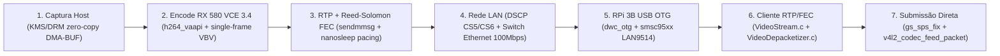

# Pipeline Host (Sunshine + RX 580 VA-API) -> Rede -> Raspberry Pi 3B: Análise e Otimização de Latência

Este documento detalha o caminho completo do frame — da captura no host Arch Linux com AMD Radeon RX 580 (`Polaris 10` / `VCE 3.4`), passando pelo encode H.264 via Mesa RadeonSI VA-API dentro do Sunshine (`v2026.1018.5342`), empacotamento UDP/RTP + FEC + QoS, até o barramento USB 2.0/Ethernet (`dwc_otg` + `smsc95xx`) e a entrega síncrona (`PDECODE_UNIT`) no cliente `moonlight-embedded-rpi3-v4l2`.

> [!NOTE]
> **Rastreabilidade das evidências**: Todas as afirmações sobre código do cliente referem-se diretamente aos arquivos do repositório. Comportamentos internos do Sunshine (`v2026.1018.5342`, commit `3d6e1d6008bd4a24906283ab25fcd0becc0a1c07`), Mesa (`1:26.2.7-1`), `libva` (`2.24.1-1`) e FFmpeg (`2:9.0.2-3`) foram verificados diretamente no sistema host (`/usr/bin/sunshine`, `/usr/share/sunshine/web/assets/Config-CuV8MZPw.js`, `en.json`, `/usr/lib/libgallium-26.2.7-arch1.1.so`, `/usr/include/va/va.h`, `vainfo`, `ffmpeg -h encoder=h264_vaapi` e `sysctl`). Detalhes obtidos por documentação/código upstream via busca (sem clone local em função de isolamento de rede) são explicitamente sinalizados como tal.

---

## 1. Visão Geral do Pipeline e Orçamento de Latência



### Orçamento de Latência Típico (720p60 H.264 em LAN Ethernet 100Mbps)

Os intervalos abaixo representam ordens de grandeza típicas inferidas da arquitetura de cada estágio (não medições instrumentadas no hardware físico específico):

| Estágio | Mecanismo Dominante | Ordem de Grandeza (720p60) | Principal Fonte de Jitter / Atraso Evitável |
| :--- | :--- | :--- | :--- |
| **1. Captura no Host** | `capture = kms` (`drm_worker` / DMA-BUF) | ~0.2 – 1.0 ms (após scanout/flip) | Usar `x11` (cópia CPU `MIT-SHM`), `portal` (PipeWire) ou cursor sem atomic KMS |
| **2. Encode VCE 3.4** | `h264_vaapi`, `async_depth = 1`, B-frames = 0 | ~2.0 – 5.0 ms (720p) | `vaapi_strict_rc_buffer = disabled` gerando picos de VBV/IDR; clocks baixos de DPM |
| **3. Pacing & TX Host** | `sendmmsg()` + `nanosleep()` + Reed-Solomon | ~0.3 – 2.5 ms | `fec_percentage` alto (`20`) e frames gigantes causando rajadas / `Skipping FEC` |
| **4. Fio Ethernet 100Mbps** | Serialização 100BASE-TX (`12.5 MB/s` teóricos) | ~0.12 ms/pacote (1.4 KB); ~1–6 ms/frame | Microburst em I-frame sem single-frame VBV; uso de Wi-Fi 2.4 GHz (`BCM43438`) |
| **5. `dwc_otg` + `smsc95xx`** | Barramento USB 2.0 compartilhado + `usbnet` | ~0.3 – 2.0 ms | `smsc95xx.turbo_mode=Y` agrupando RX; contenção USB com gamepads/receptores |
| **6. Depacketizer + V4L2** | `CAPABILITY_DIRECT_SUBMIT` -> `bcm2835-codec` | < 0.3 ms (CPU até `QBUF`) | Perda não recuperada -> espera por IDR completo (sem RFI); `SO_RCVBUF` truncado |

Para a entrada no decoder stateful `bcm2835-codec` e os estágios posteriores ao `v4l2_submit_decode_unit` (VideoCore IV, DRM/KMS/HVS e display), consulte os documentos irmãos `01-bcm2835-codec-v4l2-internals.md` (série de documentação do decoder V4L2), [`02-vc4-drm-kms-hvs-display-latency.md`](02-vc4-drm-kms-hvs-display-latency.md) e [`04-fpv-and-ingenious-low-latency-hacks.md`](04-fpv-and-ingenious-low-latency-hacks.md).

---

## 2. Auditoria da Configuração Atual no Host

Estado atual informado para o host (Arch Linux `x86_64`, RX 580 8GB, Sunshine `v2026.1018.5342`):

| Chave no `sunshine.conf` | Valor Atual | Veredito Técnico (RX 580 + RPi 3B) | Ação Recomendada |
| :--- | :--- | :--- | :--- |
| `encoder` | `vaapi` | **Correto**. Único caminho de hardware encode suportado para AMD Radeon no Linux dentro do Sunshine (Vulkan Video encode existe como opção `vulkan` na UI, mas VA-API via Gallium RadeonSI é o caminho maduro para Polaris VCE 3.4). | Manter `vaapi`. |
| `capture` | `kms` | **Ótimo**. Zero-copy via DRM/GBM/DMA-BUF (`EGL_EXT_image_dma_buf_import`), menor overhead e latência entre todos os backends Linux do Sunshine. | Manter `kms` (garantir `cap_sys_admin` e atomic modesetting ativo para cursor). |
| `vaapi_quality` | `speed` | **Correto**. Ajusta `AVCodecContext::compression_level` para o nível mais rápido reportado pelo driver em `VAConfigAttribEncQualityRange`. | Manter `speed`. |
| `vaapi_rc` | `cbr` | **Parcialmente eficaz / armadilha sem `vaapi_strict_rc_buffer`**. No binário `/usr/bin/sunshine`, ao forçar `vaapi_rc` diferente de `auto`, o VBV **não** entra em modo single-frame a menos que `vaapi_strict_rc_buffer = enabled` esteja ligado! | Ligar `vaapi_strict_rc_buffer = enabled` (ou comparar `vbr` + `vaapi_strict_rc_buffer = enabled` vs `cbr` + `vaapi_strict_rc_buffer = enabled`). |
| `min_threads` | `1` | **Sem efeito em VA-API**. Controla `AVCodecContext::thread_count` no encode por software (`libx264`). Para RX 580 + `encoder = vaapi`, é ignorado pelo caminho VAAPI. | Manter `1` (caso haja fallback `software`, mantém latência mínima de thread/slice). |
| `av1_mode` | `1` | **Seguro (redundante na prática)**. RX 580 (`vainfo`) não tem encode AV1 e o RPi 3B não tem decode HW AV1. Impede anúncio de AV1 explicitamente. | Manter `1`. |
| `sw_preset` | `ultrafast` | **Sem efeito em VA-API**. Aplicado apenas quando `encoder = software`. | Manter `ultrafast` como fallback seguro. |
| `vaapi_strict_rc_buffer` | *(padrão: `disabled`)* | **Gap crítico atual**. Sem isso, o VCE 3.4 usa VBV padrão e dispara picos enormes em mudança de cena/telas estáticas, estourando o link 100Mbps do RPi 3B ou limites de FEC. | **Definir `vaapi_strict_rc_buffer = enabled`**. |
| `hevc_mode` | *(padrão: `0`)* | O RPi 3B (VideoCore IV) só decodifica H.264 em hardware. O `moonlight-embedded` neste projeto não pede HEVC por padrão, mas travar `hevc_mode = 1` evita qualquer negociação acidental de HEVC. | **Definir `hevc_mode = 1`**. |
| `fec_percentage` | *(padrão: `20`)* | **20% de redundância excessiva** em LAN cabeada estável; gera 20% mais pacotes por bloco em cima do link de 100Mbps e do `dwc_otg`. | Reduzir para **`1` a `5`** (ou **`0`** apenas em Ethernet cabeada comprovadamente sem perdas). |
| `lan_encryption_mode` | *(padrão: `0`)* | **Crítico manter `0`**. O Cortex-A53 do RPi 3B não possui extensões ARMv8 AES (`has_fast_aes() == false` em `src/cpu.c`). Modo `2` (obrigatório) forçaria AES por software no RPi. | Garantir `lan_encryption_mode = 0`. |

---

## 3. Pipeline de Captura no Host Arch Linux (`kms` vs Alternativas)

A inspeção dos símbolos e strings em `/usr/bin/sunshine` (`v2026.1018.5342`) mostra os backends Linux expostos na UI (`Config-CuV8MZPw.js`): `nvfbc`, `wlr`, `kms`, `x11`, `kwin`, `portal`.

### Como `capture = kms` funciona no Sunshine
1. **Acesso direto ao DRM/KMS (`drm_worker` / `privileged_drm_worker`)**: O Sunshine abre os conectores/CRTCs diretamente via libdrm e importa os framebuffers da RX 580 via DMA-BUF/GBM (`EGL_EXT_image_dma_buf_import`), evitando cópias GPU->CPU->GPU ou round-trips através do compositor X11/Wayland.
2. **Privilégios sem rodar tudo como root**: O binário `/usr/bin/sunshine` usa `cap_sys_admin` (via `privileged_drm_worker` / capability no executável) para conseguir chamar `drmModeGetFB2` / acessar planos DRM mesmo com sessão gráfica ativa.
3. **Captura do cursor via Atomic Modesetting**: A inspeção do binário confirma a checagem explícita `"Atomic mode-setting must be enabled to capture the cursor!"`. Se o DRM client não operar com `DRM_CLIENT_CAP_ATOMIC` / cursor plane acessível, o cursor não é capturado separadamente no plano KMS ou exige fallback.
4. **Latência mínima no Arch Linux**: Como o scanout da GPU e o encode VCE vivem na mesma GPU (`amdgpu` / `/dev/dri/renderD128`), o `kms` envia superfícies diretamente no domínio de GPU (`VA_SURFACE` / DRM PRIME DMA-BUF) para o encoder VAAPI sem copiar pixels pela memória principal.

### Comparação com outros backends Linux (RX 580 no Arch)
- **`wlr` (`[wlgrab]`)**: Usa o protocolo `zwlr_export_dmabuf_manager_v1` (Sway/Hyprland/wlroots). Embora também seja DMA-BUF, depende do compositor exportar o frame após sua passagem de composição e segue o ritmo de apresentação/damage do compositor, adicionando tipicamente até 1 frame de compositor em comparação ao `kms` direto.
- **`kwin` (`[kwingrab]`) / `portal` (`[portalgrab]`)**: Passam pelo PipeWire + `xdg-desktop-portal` / interface KWin, introduzindo negociação de stream PipeWire, troca de buffers entre processos e atraso adicional de compositor (especialmente em KDE/GNOME).
- **`x11` (`Screencasting with X11`)**: Sem NvFBC (exclusivo NVIDIA), recorre a `XShmGetImage` (`MIT-SHM`), forçando download GPU -> RAM -> upload para superfície VAAPI, com custo alto de CPU/PCIe e tearing/vsync pior.

**Conclusão para captura**: **`capture = kms` já é a escolha ótima absoluta** para Arch Linux + RX 580 (seja em X11, Wayland ou TTY/headless com saída conectada ou dummy plug).

---

## 4. Pipeline de Encode VA-API (`Sunshine` + `Mesa RadeonSI` + `RX 580 VCE 3.4`)

### 4.1 Capacidades Reais da RX 580 (`polaris10`) no Sistema Host

Saída observada diretamente com `vainfo` (DRM driver `Mesa Gallium driver 26.2.7 for AMD Radeon RX 580 Series (radeonsi, polaris10, ...)`):
- **`VAProfileH264ConstrainedBaseline`**: `VAEntrypointVLD` (decode) e **`VAEntrypointEncSlice`** (encode)
- **`VAProfileH264Main`**: `VAEntrypointVLD` e **`VAEntrypointEncSlice`**
- **`VAProfileH264High`**: `VAEntrypointVLD` e **`VAEntrypointEncSlice`**
- **`VAProfileHEVCMain`**: `VAEntrypointVLD` e **`VAEntrypointEncSlice`**
- **`VAProfileHEVCMain10`**: `VAEntrypointVLD` apenas (sem encode 10-bit no VCE 3.4)
- **AV1**: Ausente (VCE 3.4 não possui suporte a AV1).
- **`VAEntrypointEncSliceLP` (Low-Power encode)**: **Ausente** na RX 580 Polaris 10 (`VAEntrypointEncSlice` = `6` apenas).

Opções reais expostas pelo `ffmpeg -hide_banner -h encoder=h264_vaapi` (`ffmpeg 2:9.0.2-3`):
- `idr_interval` (default `0`), `b_depth` (default `1`), `async_depth` (`1..64`, default `2`), `low_power`, `max_frame_size`, `rc_mode`, `blbrc`, `qp`, `quality`, **`coder`** (`cavlc` = `2`, `cabac` = `1`, default **`cabac`**), `aud`, `sei`, **`profile`** (`constrained_baseline`, `main`, `high`, `high10`), `level`.

### 4.2 O que o Sunshine `v2026.1018.5342` realmente envia para `h264_vaapi`

A desmontagem de `/usr/bin/sunshine` (rotinas de inicialização VAAPI correspondentes a `src/video.cpp` e `src/platform/linux/vaapi.cpp`) comprova exatamente o comportamento compilado nesta versão:

1. **Dicionário estático de opções FFmpeg para VAAPI (`0x14d740..0x14d940`)**:
   - `idr_interval = 0x7fffffff` (`INT_MAX` — suprime I-frames periódicos não solicitados; keyframes são gerados sob demanda de sessão/perda de pacote ou `IDR` inicial).
   - `async_depth = 1` (sobrescreve o padrão `2` do FFmpeg, eliminando 1 frame inteiro de enfileiramento assíncrono no pipeline VAAPI!).
   - `sei` (configurado para metadados/timing conforme suporte).
   - `blbrc` (controlado por `vaapi_blbrc`: `disabled` por padrão no schema JS, `0` ou `1`).
   - **Nenhuma opção `coder`, `profile`, `filler_data` ou `intra_refresh` é passada ao `h264_vaapi`.**
2. **Seleção de `VAProfile` e `VAEntrypoint` (`0x333ec9..0x3348e2`)**:
   - Para `AV_CODEC_ID_H264` (`0x1b`), o Sunshine **sempre** seleciona `r13d = 7` — ou seja, **`VAProfileH264High`** (`/usr/include/va/va.h:512`) — sem consultar `AVCodecContext::profile` (diferente de HEVC e AV1, que fazem switch em `profile`).
   - Para entrypoints (`0x3344c2`), testa `[8, 6]` (`VAEntrypointEncSliceLP`, depois `VAEntrypointEncSlice`), caindo em `VAEntrypointEncSlice` na RX 580.
3. **Qualidade (`vaapi_quality`) e Slices (`slices_per_frame`) (`0x33458e..0x335120`)**:
   - Consulta `VAConfigAttribEncQualityRange` e preenche `AVCodecContext::compression_level` (registrando `[VAAPI] Quality level set to ... (fastest level: ...)`). Com `vaapi_quality = speed`, seleciona o nível mais rápido.
   - Lê `videoEncoderSlicesPerFrame` do SDP do cliente (`4` enviado pelo `moonlight-embedded-rpi3-v4l2`, via `src/video/v4l2.c:277` `CAPABILITY_SLICES_PER_FRAME(4)` e `SdpGenerator.c:425-431`) e grava em `AVCodecContext::slices`, limitando ao máximo suportado pelo driver via `VAConfigAttribEncMaxSlices` (log `"Limiting slice count to encoder maximum: ..."`).
4. **Rate Control (`vaapi_rc`), `qp` e a armadilha do `vaapi_strict_rc_buffer` (`0x33481f..0x334a28`, `0x334d24..0x335000`)**:
   - O parâmetro `rc_mode` é passado via `av_dict_set` (`auto`, `vbr`, `cbr`, `cqp`, `icq`, `qvbr`).
   - Quando `vaapi_strict_rc_buffer = enabled` (ou quando `vaapi_rc = auto` dispara uma whitelist específica para drivers como `"Intel"` verificados via `vaQueryVendorString`), o Sunshine calcula explicitamente o tamanho do buffer VBV para **1 único frame**:
     `AVCodecContext::rc_buffer_size = bit_rate / frame_rate`
     e registra: `[VAAPI] Using <rc> rate control with single frame VBV size`.
   - **Com `vaapi_rc = cbr` manual e `vaapi_strict_rc_buffer = disabled` (padrão no `Config-CuV8MZPw.js`)**, o log emitido é **`"with standard VBV size"`**! Sem `rc_buffer_size = bit_rate / fps`, o VCE 3.4 adota um VBV amplo padrão (de múltiplos frames / ~1 segundo), permitindo excursões de taxa de bits bem acima da banda contratada no início de cenas complexas ou transições estático->movimento.
   - `qp`: só é aplicado para modos compatíveis (`cqp`/`icq`/`qvbr` — log `"[VAAPI] Applying QP for compatible rate control method"`), não atuando em `cbr`/`vbr`.
   - Os valores `vaapi_strict_rc_buffer`, `vaapi_rc`, `vaapi_quality` e `vaapi_blbrc` são exatamente as 4 chaves expostas na aba VAAPI em `Config-CuV8MZPw.js`; opções como `intra_refresh`, `filler_data`, `nvenc_h264_cavlc` ou `amd_coder` (esta última exclusiva de AMF/Windows) não existem para VAAPI nesta build.

> [!IMPORTANT]
> **Ação imediata recomendada**: No setup atual do usuário (`vaapi_rc = cbr`), adicionar **`vaapi_strict_rc_buffer = enabled`** no `sunshine.conf` é o ajuste mais impactante disponível sem recompilar código. Em seguida, vale comparar `vaapi_rc = cbr` vs `vaapi_rc = vbr` (ambos com `vaapi_strict_rc_buffer = enabled`), pois com VBV de 1 frame, o `vbr` evita preenchimento/degradação desnecessária em cenas paradas mantendo o teto rígido por frame.

### 4.3 H.264 Constrained Baseline + CAVLC vs Main/High + CABAC (RX 580 -> RPi 3B VideoCore IV)

Embora `vainfo` confirme que a RX 580 suporta `VAProfileH264ConstrainedBaseline` (`13`) e o FFmpeg `h264_vaapi` suporte `-profile constrained_baseline` + `-coder cavlc`:

1. **O que acontece hoje no cliente e no host**:
   - No host, o Sunshine `v2026.1018.5342` fixa `VAProfileH264High` (`7`) e não passa `coder=cavlc`, fazendo o FFmpeg usar **`coder=cabac`** (default) em **High Profile**.
   - No cliente, `v4l2_submit_decode_unit` (`src/video/v4l2.c:248-250`) executa `gs_sps_fix(..., GS_SPS_BITSTREAM_FIXUP, ...)` (`libgamestream/sps.c:33-83`). Isso reescreve `level_idc` (`32` em 720p, `42` em 1080p), `num_ref_frames = 1`, `max_dec_frame_buffering = 1` e — caso `vui.bitstream_restriction_flag` esteja zerado — ativa `bitstream_restriction_flag = 1` com `num_reorder_frames = 0` (nota: sem forçar `vui_parameters_present_flag = 1` se o SPS original vier sem VUI).
   - **Limitação fundamental do `gs_sps_fix`**: Alterar o SPS no cliente **não modifica** a codificação de entropia dentro dos slices (`entropy_coding_mode_flag` no PPS / macroblocos) nem remove ferramentas do perfil High (como transformada 8x8 `transform_8x8_mode_flag` no PPS). Ele apenas garante `num_ref_frames = 1` e `reorder = 0` no DPB.

2. **Impacto teórico e prático de CAVLC + Constrained Baseline no VideoCore IV vs High + CABAC**:
   - **CAVLC vs CABAC**: CABAC é sequencial por dependência de contexto aritmético binário, exigindo mais ciclos no bloco de entropia do VideoCore IV em bitrates elevados ou cenas ruidosas; **CAVLC** é mais simples/paralelizável e gera menor variância (jitter) de tempo de decode no RPi 3B. Em contrapartida, CAVLC consome tipicamente **~10% a 15% mais bitrate** para a mesma qualidade visual que CABAC — um custo aceitável em 720p60 a 10–15 Mbps numa LAN 100Mbps, mas relevante se tentar espremer 1080p60 no link de 100Mbps.
   - **Constrained Baseline vs High**: O encoder Sunshine já opera com `B-frames = 0` (`max_b_frames = 0` / baixa latência); porém Constrained Baseline proíbe formalmente B-slices, CABAC e transformada 8x8 no próprio bitstream/PPS.

3. **Como obter CAVLC/Constrained Baseline se desejar testar no Arch Linux**:
   - Via configuração pura do Sunshine `v2026.1018.5342` **não há chave exposta** (diferente de `nvenc_h264_cavlc` na aba NVENC).
   - Existem dois caminhos apenas com modificação no host:
     1. **Patch pequeno no Sunshine** (em `src/video.cpp` / `src/platform/linux/vaapi.cpp`, compilando pacote local `sunshine-git`/PKGBUILD): adicionar `av_dict_set(&options, "coder", "cavlc", 0)` e `av_dict_set(&options, "profile", "constrained_baseline", 0)` além de mapear `VAProfileH264ConstrainedBaseline` (`13`) na consulta de entrypoint VAAPI.
     2. Testar primeiramente em laboratório via CLI do `ffmpeg` (`h264_vaapi -profile:v constrained_baseline -coder cavlc`) e inspecionar logs/tempos de decode no RPi 3B antes de manter um fork local do Sunshine — frequentemente `vaapi_strict_rc_buffer = enabled` + `slices_per_frame = 4` + `720p60` já resolve a maior parte dos engasgos mantendo `High + CABAC` stock.

### 4.4 Quirks da RX 580 (Polaris 10 / VCE 3.4) e Mesa 26.2.7 (`radeonsi`)

1. **`AMD_DEBUG=lowlatencyenc` (injetado automaticamente pelo Sunshine)**:
   - A inspeção em `/usr/bin/sunshine` (`0x384840..0x384a59`) confirma que o próprio Sunshine define `AMD_DEBUG=lowlatencyenc` no ambiente de inicialização (junto a flags RADV `RADV_PERFTEST=video_encode` / `RADV_EXPERIMENTAL`).
   - Em `/usr/lib/libgallium-26.2.7-arch1.1.so`, `lowlatencyenc` corresponde ao bit `0x4` da tabela de debug do `radeonsi`. Na documentação/upstream Mesa, esse flag foi introduzido especificamente visando blocos **VCN** (`src/gallium/drivers/radeonsi/mm/radeon_vcn_enc.c`) para evitar redução agressiva de clock/buffering e manter menor latência de entrega em streaming em tempo real (com maior consumo energético). A RX 580 usa **VCE 3.4** (`src/gallium/drivers/radeonsi/mm/radeon_vce.c`), geração anterior ao VCN; portanto esse flag não prejudica, mas tampouco substitui manter clocks estáveis na GPU via perfil de energia `amdgpu` caso ocorram quedas de `VCLK` entre frames estáticos.
2. **`VAAPI_DISABLE_INTERLACE` é obsoleto/inexistente no Mesa 26.2.7**:
   - Buscas de strings e símbolos em `/usr/lib/libgallium-26.2.7-arch1.1.so` confirmam que **`VAAPI_DISABLE_INTERLACE` não existe mais** no Mesa 26.2.7 (foi removido em revisões anteriores do driver). Não é necessário defini-lo no ambiente.
3. **Múltiplos slices (`slices_per_frame = 4`) na VCE 3.4**:
   - O cliente (`src/video/v4l2.c:277`) anuncia `CAPABILITY_SLICES_PER_FRAME(4)`, enviado via RTSP (`x-nv-video[0].videoEncoderSlicesPerFrame: 4` em `SdpGenerator.c:425-431`). O Sunshine repassa isso para `AVCodecContext::slices` (limitado ao máximo reportado pela VCE 3.4 em `VAConfigAttribEncMaxSlices`). Entretanto, **não há entrega sub-frame/por-slice na rede nem no cliente**: `VideoDepacketizer.c` (`reassembleFrame`) aguarda o frame completo (`FLAG_EOF` e bloco FEC) antes de chamar `v4l2_submit_decode_unit`, e o decoder stateful `bcm2835-codec` consome Access Units inteiras. Na VCE 3.4, dividir em 4 slices introduz pequeno overhead extra de cabeçalhos de slice por frame; testar `slices_per_frame = 1` vs `4` exige editar/recompilar a flag no cliente (`v4l2.c`), com potencial economia marginal de bits sem perda de paralelismo real no RPi 3B.
4. **`vaapi_blbrc` (`disabled` por padrão)**:
   - Disponível no FFmpeg 9.0.2 (`blbrc`) e no Sunshine `v2026.1018.5342`. Permite ao rate control do hardware ajustar QP por bloco conforme complexidade/bitrate. Em testes de latência estrita no RX 580 + `vaapi_strict_rc_buffer = enabled`, manter `disabled` evita variação extra na fase de análise/rate control, podendo ser habilitado depois apenas se houver artefatos de blocagem severos no bitrate alvo.

---

## 5. Transporte de Rede, FEC, Pacing & Entrega no Cliente

### 5.1 Negociação RTSP/SDP e Criptografia (`moonlight-common-c` <-> Sunshine)

A leitura direta de `src/config.c`, `src/cpu.c`, `third_party/moonlight-common-c/src/Connection.c` e `SdpGenerator.c` estabelece exatamente o que o cliente RPi 3B negocia com o host:

1. **Tamanho de pacote (`packetSize`)**:
   - Padrão em `src/config.c:348`: `config->stream.packetSize = 1392`.
   - `Connection.c:295` alinha para baixo em múltiplo de 16: `StreamConfig.packetSize -= StreamConfig.packetSize % 16;`.
   - `Connection.c:399-410`: se a conexão for classificada como `STREAM_CFG_REMOTE` (fora da LAN), o cliente limita automaticamente `packetSize` para `1024` (IPv4) ou `1184` (IPv6).
   - `SdpGenerator.c:322-329`: se criptografia de vídeo (`SS_ENC_VIDEO`) estiver ativa, subtrai `sizeof(ENC_VIDEO_HEADER)` (32 bytes, `Video.h:15-19`), reduzindo `1392` para **`1360`** bytes de payload útil no SDP (`x-nv-video[0].packetSize`).
2. **Criptografia de vídeo no RPi 3B (`src/cpu.c:73-121`, `src/config.c:353-364`)**:
   - `has_fast_aes()` verifica `HWCAP2_AES` / `HWCAP_AES`. O BCM2837 (ARM Cortex-A53 do RPi 3B no silício da Raspberry Pi Foundation) **não possui instruções Crypto/AES em hardware**, portanto `has_fast_aes()` retorna `false` (e `has_slow_aes()` também é `false`, reservado a ARMv6).
   - Consequência: o cliente solicita **`ENCFLG_AUDIO`** (criptografa apenas áudio, **vídeo sem criptografia**) desde que o Sunshine tenha `lan_encryption_mode = 0` (padrão) ou `1` (opcional). Se você definir `lan_encryption_mode = 2` no Sunshine, forçará AES em software na CPU do RPi 3B e perderá 32 bytes de payload por pacote!
3. **Bitrate anunciado no SDP (`SdpGenerator.c:337,369-372`)**:
   - O cliente envia **80% do bitrate pedido** (`0.80 * StreamConfig.bitrate`) nos campos `initialBitrateKbps`, `initialPeakBitrateKbps`, `minimumBitrateKbps` e `maximumBitrateKbps`, e envia o valor integral (`StreamConfig.bitrate`) em `x-ml-video.configuredBitrateKbps`. O Sunshine (`v2026.1018.5342`) utiliza o campo estendido `x-ml-video.configuredBitrateKbps` quando presente (`x-ml-general.featureFlags: 3` em `SdpGenerator.c:271-273`).
4. **Parâmetros de streaming e FEC solicitados pelo cliente**:
   - `x-nv-vqos[0].qosTrafficType: 5` (LAN) ou `0` (remoto) (`SdpGenerator.c:399-406`).
   - `x-nv-video[0].maxNumReferenceFrames: 1` (`SdpGenerator.c:466-474`, atribuído na linha `473`).
   - `x-nv-video[0].videoEncoderSlicesPerFrame: 4` (`src/video/v4l2.c:277`, `SdpGenerator.c:425-431`).
   - `x-nv-vqos[0].fec.minRequiredFecPackets: 2` (`SdpGenerator.c:210`) e `x-nv-vqos[0].bllFec.enable: 0` (`SdpGenerator.c:217`).

### 5.2 QoS, Envio em Lote, Pacing e Limites de FEC no Sunshine

A desmontagem de `/usr/bin/sunshine` (`0x2a9183..0x2a92cf`, `0x2b4b00..0x2b6750`, `0x37e1c0..0x37e320`) revela mecanismos cruciais na transmissão UDP do host:

1. **Marcação QoS e Buffer de Envio (`setsockopt` em `0x37e1c0..0x37e2ea`)**:
   - Configura **`IP_TOS` / `IPV6_TCLASS`**: `0xa0` (**DSCP 40 / CS5**, tipicamente vídeo em tempo real) ou `0xc0` (**DSCP 48 / CS6**, controle/áudio), dependendo do canal.
   - Configura **`SOL_SOCKET, SO_PRIORITY`**: `5` (vídeo) ou `6` (áudio/controle), exatamente compatível com o lado cliente (`PlatformSockets.c`).
   - Configura **`SOL_SOCKET, SO_SNDBUF`** no socket UDP do servidor.
2. **Batching (`sendmmsg`) e Pacing (`nanosleep`)**:
   - No Linux, o Sunshine envia pacotes em lote via **`sendmmsg()`** (`0x2b605b`), com fallback automático para `sendmsg()` (`0x2b5a3a`, log `"Falling back to unbatched send"`) caso a syscall falhe/não suporte, usando `poll()` em caso de `EAGAIN`.
   - Entre envios/blocos, realiza pacing temporal usando `std::chrono::steady_clock::now()` e **`nanosleep()`** (`0x2b5044..0x2b50cb`) para evitar despejar todos os datagramas UDP de um I-frame no hardware em 0 microssegundos — ainda assim, a granularidade de `nanosleep()` no kernel Linux (~tens de microssegundos + timer slack) e o `sendmmsg()` em rajadas continuam gerando microbursts concentrados quando um frame é grande.
3. **Limites rígidos do Reed-Solomon FEC (`0x2b4b83..0x2b4bb8`, `0x2b552f`)**:
   - Cada bloco FEC obedece estritamente:
     - `1 <= data_shards <= 255`
     - `1 <= parity_shards <= 255`
     - **`data_shards + parity_shards <= 255`** (`DATA_SHARDS_MAX = 255`).
   - Se o frame codificado estourar esse teto (e/ou os blocos permitidos), o Sunshine registra `"Skipping FEC for abnormally large encoded frame (needed ..."` ou `"Encoder produced a frame too large to send!..."`!
   - **Impacto prático em `1392` bytes + `fec_percentage = 20`**: `floor(255 / 1.20) = 212` shards de dados no máximo por bloco FEC (~290 KB por bloco). Um I-frame sem VBV rígido de `15–25 Mbps` frequentemente ultrapassa 290 KB numa mudança brusca de cena, perdendo proteção FEC justamente no frame mais crítico!
   - **Piso dinâmico (`minRequiredFecPackets = 2`)**: Quando o FEC está ativo, o Sunshine garante o piso de `minRequiredFecPackets` (`2` pedidos no SDP pelo `SdpGenerator.c:210`), recalculando `100 * parity_needed / data_shards` (`0x2b552f`) e registrando `"Increasing FEC percentage to ... to meet parity shard minimum"`. Em P-frames pequenos (ex.: 4 a 10 pacotes de dados), `fec_percentage = 1` ou `20` ambos acabarão gerando os mesmos **2 pacotes de paridade**! Já em frames maiores (ex.: 60–150 pacotes), `fec_percentage = 1..5` reduz drasticamente a rajada comparado a `20`.

### 5.3 Recepção, Depacketization e Entrega Síncrona no Cliente (`moonlight-common-c` -> `v4l2.c`)

1. **Buffer UDP e Prioridade de Socket (`VideoStream.c:26,35,331-333`, `PlatformSockets.c:266-288,364-386`)**:
   - `VideoStream.c` define `RTP_RECV_PACKETS_BUFFERED = 2048` e solicita `SO_RCVBUF = 2048 * (packetSize + MAX_RTP_HEADER_SIZE)` (~2.88 MB para `packetSize = 1392`).
   - Em `PlatformSockets.c:364-386`, se o kernel recusar o valor por causa de `net.core.rmem_max`, o loop reduz `bufferSize` em passos de `RCV_BUFFER_SIZE_STEP` (`16384` bytes) até ser aceito! **Se `net.core.rmem_max` no RPi 3B estiver no padrão baixo de alguns kernels (ex.: ~200 KB), o socket ficará com buffer pequeno e perderá pacotes durante rajadas de I-frame!**
   - `PlatformSockets.c:266-288` aplica `SO_PRIORITY = 5` (vídeo) / `6` (áudio), enquanto `enterLowLatencyMode()` (`PlatformSockets.c:872-944`) é um `#else` vazio (no-op) no Linux.
   - `VideoReceiveThreadProc` usa `SO_RCVTIMEO = 100ms` como timeout de polling/desbloqueio.
2. **Fila RTP e Reed-Solomon (`RtpVideoQueue.c`)**:
   - Calcula `bufferParityPackets = (bufferDataPackets * fecPercentage + 99) / 100`.
   - Mantém recuperação FEC por bloco e tentativa de NACK/RFI especulativo (`stageCompleteFecBlock` -> `submitCompletedFrame`).
3. **Entrega Direta sem Fila Extra (`VideoDepacketizer.c:512-539,984-996,1069-1123` + `src/video/v4l2.c:277`)**:
   - `v4l2.c` declara **`CAPABILITY_DIRECT_SUBMIT | CAPABILITY_SLICES_PER_FRAME(4)`**.
   - Graças a `CAPABILITY_DIRECT_SUBMIT`, `VideoDepacketizer.c:512-539` **ignora a `decodeUnitQueue`** (zero thread/fila intermediária!): assim que chega o pacote final (`(flags & FLAG_EOF) && fecCurrentBlockNumber == fecLastBlockNumber`), remove NAL `9` (AUD) e NAL `6` (SEI) (`VideoDepacketizer.c:984-996`) e chama `reassembleFrame` -> `v4l2_submit_decode_unit` -> `gs_sps_fix` -> `v4l2_codec_feed_packet` diretamente no mesmo contexto da thread de recepção!
   - **Ponto de atenção crítico (`RFI`)**: O backend `v4l2.c` **não** declara `CAPABILITY_REFERENCE_FRAME_INVALIDATION_AVC`. Isso significa que, se um único pacote UDP de vídeo for perdido e o FEC não conseguir reconstruí-lo, o cliente precisa descartar o frame corrompido e aguardar um **IDR frame inteiro novo** do Sunshine (congelamento visível de dezenas/centenas de milissegundos). Por isso, em redes com perda mínima, manter um FEC leve (`fec_percentage = 2..5`) ou garantir zero perda de pacotes na camada USB/Ethernet é muito mais estável do que zerar o FEC às cegas.

---

## 6. Gargalos do Raspberry Pi 3B (`dwc_otg` + `smsc95xx` vs Wi-Fi `brcmfmac`) e Tuning de Kernel

### 6.1 Arquitetura USB 2.0 OTG Compartilhada no RPi 3B

No Raspberry Pi 3 Model B (SoC BCM2837):
- Existe apenas **um único controlador USB 2.0 OTG (`dwc_otg`, 480 Mbps half-duplex teórico)** conectado ao chip combinado hub + Ethernet **SMSC/Microchip LAN9514 (`smsc95xx`, 100BASE-TX Fast Ethernet, 100 Mbps full-duplex no cabo, limitado a USB 2.0 internamente)**.
- Todo o tráfego de vídeo UDP chegando pela porta Ethernet **divide exatamente o mesmo barramento USB 2.0, as mesmas interrupções/FIQ (`dwc_otg` FIQ FSM) e os mesmos microframes de 125 µs** com qualquer **gamepad USB, receptor wireless USB (ex.: 2.4 GHz), teclado ou mouse** plugado no RPi 3B!
- Consequência prática: se um I-frame gerar um microburst UDP pesado saturando o enlace Ethernet/USB e o driver acumular múltiplos frames por transação USB, há dupla penalidade: **jitter no vídeo** e **latência/perda de polling USB no gamepad (HID)**.

### 6.2 Mitos vs Fatos do Driver `smsc95xx` no Kernel Linux

Ao otimizar Linux em x86/PCIe, muitas dicas comuns são inúteis ou incorretas no RPi 3B (`smsc95xx` + `usbnet`). A análise das fontes do kernel (`drivers/net/usb/smsc95xx.c` e `usbnet.c`) mostra o que realmente existe:

| Tuning / Ferramenta | Funciona no RPi 3B (`smsc95xx`)? | Explicação Técnica Real |
| :--- | :--- | :--- |
| **`smsc95xx.turbo_mode=N`** (`/boot/.../cmdline.txt`) | **SIM (Alto impacto em jitter)** | Com `turbo_mode=Y` (padrão), o LAN9514 agrega múltiplos pacotes Ethernet recebidos em uma única transação/URB USB maior para elevar throughput máximo, introduzindo atraso de espera/serialização e picos de alocação. `smsc95xx.turbo_mode=N` entrega cada frame Ethernet imediatamente ao `usbnet` -> `netif_rx()`, reduzindo jitter a um custo modesto de CPU e teto de throughput (ainda mais que suficiente para 10–20 Mbps). |
| **`SO_BUSY_POLL` / `net.core.busy_poll`** | **NÃO tem efeito** | `usbnet` encaminha pacotes via `netif_rx()` (sem NAPI `napi_poll` no `smsc95xx`). Não há loop NAPI no driver USB para busy-polling capturar. |
| **`ethtool -C eth0 ...`** (Interrupt Coalescing) | **NÃO suportado** | `smsc95xx_ethtool_ops` não implementa `.get_coalesce` / `.set_coalesce` (retorna `Operation not supported`). A coalescência efetiva em RX é controlada indiretamente por `turbo_mode`. |
| **`ethtool --set-eee eth0 eee off`** (IEEE 802.3az) | **NÃO aplicável ao RPi 3B** | O LAN9514 (`smsc95xx`) do **RPi 3B** é Fast Ethernet 100Mbps legado e **não** tem EEE 802.3az (esse recurso/problema surgiu apenas no **RPi 3B+** com Gigabit LAN7515 / driver `lan78xx`!). |
| **`ethtool -A eth0 rx off tx off`** (Pause Frames 802.3x) | **SIM (Suportado)** | `smsc95xx_ethtool_ops` suporta parâmetros de pause. Desativar pause frames evita que um switch envie frames `PAUSE` paralisando rajadas inteiras (útil se o switch estiver estável e sem bufferbloat). |
| **Wi-Fi onboard (`BCM43438`, `brcmfmac`)** | **Inferior à Ethernet — usar apenas se inevitável** | No **RPi 3B**, o módulo `BCM43438` opera **apenas em 2.4 GHz (802.11n)** — sem 5 GHz! Além disso, o `brcmfmac` habilita `power_save: on` por padrão, gerando picos de dezenas de ms. Se precisar usar Wi-Fi, é obrigatório desabilitar com **`iw dev wlan0 set power_save off`** (o antigo `iwconfig wlan0 power off` está obsoleto; persistir via NetworkManager `wifi.powersave = 2` ou unit `systemd`). |

### 6.3 Dimensionamento de Bitrate, MTU/`-packetsize` e FEC para 100Mbps

1. **`-packetsize 1392` (padrão em `src/config.c:348`)**:
   - Em Ethernet padrão (MTU `1500` bytes), após cabeçalhos IPv4 (20 B) + UDP (8 B) + cabeçalho RTP/NV (16 B) + eventuais bytes de padding/alinhamento, `1392` bytes maximiza a eficiência de payload útil **sem fragmentação IP**, mantendo `packetSize % 16 == 0` (`Connection.c:295`).
   - Pacotes maiores (`1392` vs `1024`) também **reduzem o número total de datagramas UDP e micro-interrupções USB** por segundo na razão `1392 / 1024` (~26% menos pacotes/URBs para o mesmo bitrate!) e afastam os I-frames do teto `DATA_SHARDS_MAX = 255` shards no Sunshine. Só reduza para `1024`–`1200` se houver túneis VPN/PPPoE na rota reduzindo a MTU abaixo de `1460`.
2. **Bitrate alvo (`-bitrate`) no RPi 3B (720p60)**:
   - Embora 100BASE-TX suporte ~94 Mbps contínuos em carga TCP/bulk, em streaming com `1392` B e I-frames/cenas dinâmicas, um bitrate médio alto eleva os microbursts instantâneos para várias vezes a média, competindo com controles no `dwc_otg` e arriscando estourar `255` shards FEC.
   - Faixa ótima prática para **720p60**: **`8000` a `15000` kbps (`8–15 Mbps`)** combinado obrigatoriamente com `vaapi_strict_rc_buffer = enabled` no Sunshine (mantendo cada frame estritamente dentro de ~17–31 KB na média por 1/60s!). Acima de `20–25 Mbps` em LAN 100Mbps + `smsc95xx` traz risco desproporcional de micro-stutter por rajada sem ganho real visível em 720p.
3. **`fec_percentage`**:
   - Em Ethernet cabeada limpa via switch dedicado: **`1` a `5`** (ex.: **`2`** ou **`5`**) com **`vaapi_strict_rc_buffer = enabled`**. Isso mantém os **2 pacotes de paridade mínimos** exigidos por `minRequiredFecPackets: 2` (`SdpGenerator.c:210`) em P-frames menores, reduz drasticamente o overhead nos frames maiores em relação ao padrão `20`, e preserva proteção contra qualquer descarte eventual sem provocar a espera longa por IDR completo (já que `v4l2.c` não tem RFI).
   - **`fec_percentage = 0`**: opção válida **somente** se testes prolongados provarem 0% de perda UDP na sua rede, eliminando 100% da paridade FEC ao custo de congelar até o próximo IDR se um único datagrama cair.

### 6.4 Tuning de Kernel no Host (Arch Linux) e no Cliente (RPi 3B)

#### Host Arch Linux (`x86_64`)
Verificado diretamente via `sysctl` no host atual:
- `net.core.rmem_max = 4194304` e `net.core.wmem_max = 4194304` **já vêm configurados em 4 MB** no Arch Linux atual (`4194304`), adequados para `SO_SNDBUF`/`SO_RCVBUF` do Sunshine. (`net.core.wmem_default = 212992`).
- **Disciplina de fila (`qdisc`)**: Em `/etc/sysctl.d/99-sunshine-latency.conf`, usar `net.core.default_qdisc = fq` ou `fq_codel` (no Arch/systemd moderno `fq_codel` já costuma ser padrão; `fq` ainda permite pacing preciso por socket caso algum componente utilize `SO_TXTIME` e evita bufferbloat na fila de saída).
- **NIC do Host (via `ethtool` / serviço udev/systemd)**:
  - Desabilitar segmentação UDP offload se a placa apresentar coalescência agressiva: `ethtool -K <iface> tx-udp-segmentation off` (se suportado).
  - Em interfaces Intel/Realtek/Atheros PCIe no host, se suportado por `ethtool -c <iface>`, testar `rx-usecs 0` / `tx-usecs 0` (ou valores baixos como `10–25 µs`) para evitar retenção artificial antes de disparar os pacotes UDP da RX 580.
  - Garantir `Disable` de `EEE` no host (`ethtool --set-eee <iface> eee off`, se suportado) para que o link Gigabit do PC não entre em LPI entre rajadas de áudio/controle.

#### Cliente Raspberry Pi 3B
- **Aumentar `rmem_max` para >= 4 MB**: Como `VideoStream.c` solicita **`~2.88 MB`** em `SO_RCVBUF` (`2048 * ~1408` bytes), **qualquer kernel no RPi 3B com `net.core.rmem_max` padrão baixo (ex.: `212992`) forçará `PlatformSockets.c` a reduzir o buffer de recepção**, aumentando risco de drops silenciosos (`RcvbufErrors` em `/proc/net/snmp`). Configurar `net.core.rmem_max = 4194304` e `net.core.rmem_default = 1048576` garante que o `setsockopt(SO_RCVBUF)` passe de primeira.
- **Desabilitar batching RX no LAN9514**: `smsc95xx.turbo_mode=N` em `/boot/firmware/cmdline.txt` (ou `/boot/cmdline.txt` em imagens antigas).
- **Desativar PAUSE frames** (opcional, se switch suportar): `ethtool -A eth0 rx off tx off`.
- **Wi-Fi (apenas se usar `wlan0`)**: `iw dev wlan0 set power_save off`.

---

## 7. Checklist e Receita Prática de Configuração

### 7.1 `sunshine.conf` recomendado (Host Arch Linux + RX 580)

```ini
# Captura e Encoder
capture = kms
encoder = vaapi
vaapi_quality = speed
vaapi_rc = cbr
vaapi_strict_rc_buffer = enabled
vaapi_blbrc = disabled

# Codecs: restringir cliente RPi 3B a H.264 HW
hevc_mode = 1
av1_mode = 1

# Rede e FEC (para LAN Ethernet cabeada -> RPi 3B)
fec_percentage = 5
lan_encryption_mode = 0

# Fallback caso software encoder seja acionado
min_threads = 1
sw_preset = ultrafast
```

> [!TIP]
> **Teste A/B recomendado no host**: Após ativar `vaapi_strict_rc_buffer = enabled`, compare `vaapi_rc = cbr` contra `vaapi_rc = vbr` observando nos logs do Sunshine se aparece `[VAAPI] Using ... rate control with single frame VBV size` e verificando se ocorre algum `Skipping FEC for abnormally large encoded frame` durante transições bruscas de tela.

### 7.2 Parâmetros do Cliente (`moonlight-embedded-rpi3-v4l2`)

```bash
moonlight stream -720 -fps 60 -bitrate 12000 -packetsize 1392 -codec h264 <IP_DO_HOST>
```
*(Ajustar `-bitrate` entre `10000` e `15000` conforme sensibilidade a artefatos vs estabilidade de USB/gamepad na sua LAN).*

### 7.3 Tuning no Raspberry Pi 3B

1. **`/boot/firmware/cmdline.txt`** (mesma linha contínua, sem quebras):
   ```text
   ... rootwait smsc95xx.turbo_mode=N
   ```
2. **`/etc/sysctl.d/99-moonlight-rpi3.conf`**:
   ```ini
   net.core.rmem_max = 4194304
   net.core.rmem_default = 1048576
   ```
3. **Se usar Ethernet com switch gerenciável/Flow Control** (via serviço systemd pós-boot):
   ```bash
   ethtool -A eth0 rx off tx off
   ```
4. **Se usar Wi-Fi 2.4 GHz (`wlan0`)**:
   ```bash
   iw dev wlan0 set power_save off
   ```

> [!NOTE]
> Aplicações via `sysctl`, `ethtool`, `iw` e edição em `/boot/firmware/cmdline.txt` exigem privilégio administrativo no RPi 3B / host Arch (utilize `pkexec` ou seu fluxo administrativo habitual quando aplicável).

### 7.4 Comandos de Diagnóstico e Validação

- **Confirmar que o Sunshine ativou Single-Frame VBV e VAAPI sem erros**:
  ```bash
  journalctl --user -u sunshine -n 120 | grep -E "VAAPI|VBV|FEC|Encoder produced|Increasing FEC|Skipping FEC"
  ```
- **Confirmar capacidades VCE 3.4 no Arch Linux**:
  ```bash
  vainfo --display drm --device /dev/dri/renderD128 | grep -E "H264|HEVC|EncSlice"
  ```
- **Verificar drops UDP (`RcvbufErrors` / `InErrors`) no RPi 3B durante o stream**:
  ```bash
  watch -n 1 "grep -A1 '^Udp:' /proc/net/snmp && cat /sys/class/net/eth0/statistics/rx_dropped"
  ```
- **Confirmar `turbo_mode` ativo/inativo e `rmem_max` no RPi 3B**:
  ```bash
  cat /sys/module/smsc95xx/parameters/turbo_mode
  sysctl net.core.rmem_max net.core.rmem_default
  ```

---

## 8. Referências

- **Repositório local (cliente `moonlight-embedded-rpi3-v4l2` & `moonlight-common-c`)**:
  - `src/config.c`, `src/cpu.c`, `src/video/v4l2.c`, `libgamestream/sps.c`
  - `third_party/moonlight-common-c/src/Connection.c`, `SdpGenerator.c`, `VideoStream.c`, `PlatformSockets.c`, `RtpVideoQueue.c`, `VideoDepacketizer.c`, `Video.h`
- **Sunshine (`v2026.1018.5342`, commit `3d6e1d6008bd4a24906283ab25fcd0becc0a1c07`)**:
  - Documentação oficial: <https://docs.lizardbyte.dev/projects/sunshine/latest/>
  - Repositório: <https://github.com/LizardByte/Sunshine> e página inicial: <https://app.lizardbyte.dev/Sunshine>
  - Artefatos inspecionados no host: `/usr/bin/sunshine`, `/usr/share/sunshine/web/assets/Config-CuV8MZPw.js`, `/usr/include/va/va.h`
- **Mesa (`1:26.2.7-1`, RadeonSI / VCE & VCN)**:
  - Projeto e variáveis de ambiente: <https://www.mesa3d.org/> e <https://docs.mesa3d.org/envvars.html>
  - Artefato inspecionado no host: `/usr/lib/libgallium-26.2.7-arch1.1.so` (`radeonsi/mm/radeon_vce.c`, `radeonsi/mm/radeon_vcn_enc.c`)
- **Kernel Linux (`smsc95xx` / `usbnet` no RPi 3B)**:
  - Driver LAN95xx: <https://github.com/torvalds/linux/blob/master/drivers/net/usb/smsc95xx.c>
